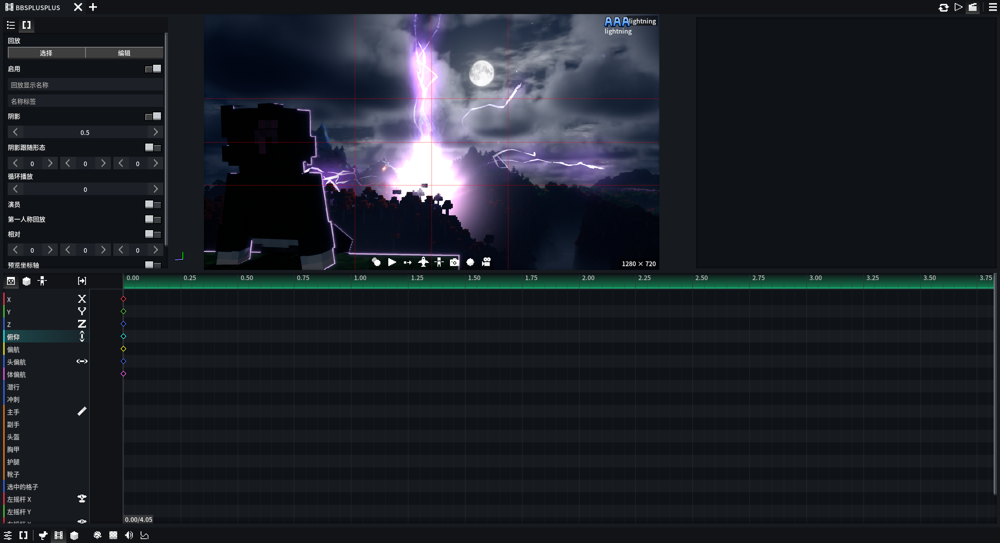
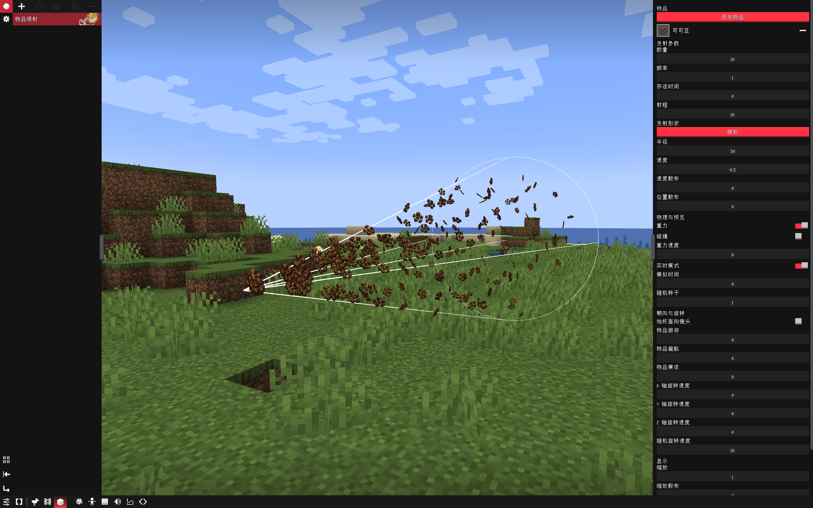
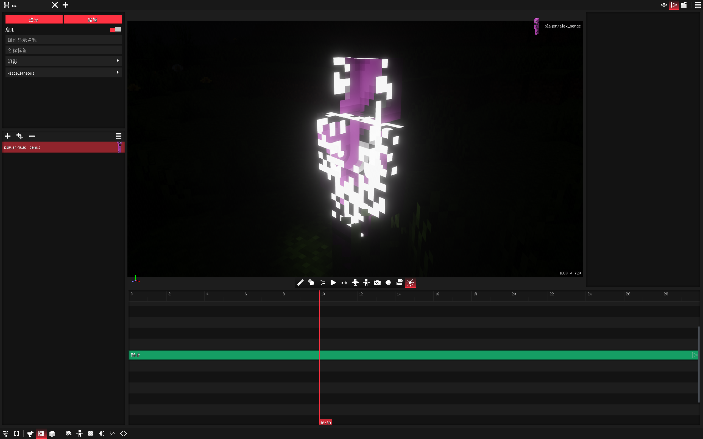

# BBS Cubed

> [BBSFS](https://github.com/Wemppy4/bbs-fs) 功能增强插件
>
> **构建状态**：1.20.1 为主发布目标（单 jar 兼容 1.20.1–1.20.4）；1.21.11 为实验性构建，约 20% 的渲染 / UI / 第三方插件适配代码尚未移植（构建时排除）。

**简体中文** | [English](README_EN.md)

  

## 功能一览

### 可配置项

| 功能                   | 默认 | 说明                                                                                                                         |
| ---------------------- | ---- | ---------------------------------------------------------------------------------------------------------------------------- |
| **BBS增强**      |      |                                                                                                                              |
| 中文关键帧轨道名称     | 关   | 将关键帧编辑器中的轨道名称显示为中文。可通过修改语言文件 `bbspp.keyframe.*` 添加/修改翻译，硬编码表兜底                     |
| 编辑器自动切换旁观模式 | 关   | 打开影片编辑器时自动切换到旁观模式，关闭时恢复                                                                             |
| 禁止出现负数关键帧     | 关   | 开启后禁止在关键帧编辑器中将关键帧拖动或添加到 0 秒之前                                                                     |
| Shift 直接选择父级     | 关   | 开启后，按住 Shift 在"回放编辑器"、"模型编辑器"中点击模型部位时，不再弹出层级选择菜单，而是直接选中其父骨骼                  |
| 姿势骨骼树形列表       | 关   | 开启后，姿势编辑器的骨骼列表按模型父子层级缩进并绘制树形连接线；搜索时仍平铺显示匹配项                                       |
| 第一人称视角晃动       | 关   | 开启后，播放"第一人称回放"时还原原版的行走视角晃动效果                                                                      |
| 全新伪装界面布局       | 关   | 开启后伪装界面使用全新的双栏布局；关闭后使用原版垂直布局                                                                    |
| 全新影片库界面         | 关   | 开启后影片面板主页替换为快捷栏 + 根目录列 + 向右展开子列的工作区，支持双击打开、拖拽移动、搜索与排序        |
| 反转时间线滚轮方向     | 关   | 开启后反转影片编辑器中滚轮驱动的时间线方向，包括 Ctrl+滚轮移动播放头、Alt+滚轮移动选中关键帧或剪辑，以及 Alt+滚轮左右滚动时间 |
| 光影控制按钮           | 关   | 在影片编辑器中添加光影控制按钮，左键开/关，右键打开光影选择界面                                                             |
| 新光影曲线选择界面     | 关   | 开启后在曲线剪辑中添加光影曲线时使用按光影设置分类的新界面；关闭后使用 BBS 原版平铺列表                                     |
| Blockbench 程序路径    | 空   | 在伪装页右键用 Blockbench 打开用户模型前，在此选择 Blockbench.exe 的位置                                                    |
| 优先使用 .bbmodel      | 开   | 模型目录下存在 .bbmodel 工程文件时，右键打开优先使用它；否则打开 .geo.json                                                   |
| 关键帧布局深度锁定     | 关   | 开启后若关键帧编辑器布局被锁定，左侧轨道名称与右侧轨道之间的调节柄一并隐藏，不再允许调节宽度                                  |
| 世界播放应用光影曲线   | 关   | 开启后使用右 Ctrl 在世界内播放影片时，曲线剪辑中的太阳、天气、天空色以及 Iris 光影包参数也会生效                             |
| 允许拖动扩展剪辑轨道   | 关   | 开启后将整段剪辑继续拖到时间线顶部之外时不再限制轨道层级，可像原版 BBS 一样创建更多轨道                                     |
| 使用 BBS Cubed 专用剪贴板 | 关   | 开启后回放、关键帧、形态、变换等 BBS 专用复制数据保存在 BBS Cubed 内部，不再写入系统剪贴板                                   |
| Alt 滚轮时间线行为     | 默认 | 设置影片编辑器关键帧视图中，未选中关键帧时按住 Alt 滚动鼠标滚轮的行为                                                       |
| IK 目标约束            | 开   | 开启后保持原版行为，IK 目标不能选择本 IK 链自身的骨骼（防止形成循环）；关闭后允许选择链上骨骼作为 IK 目标，求解结果可能异常 |
| **物品喷射**     |      |                                                                                                                              |
| 视野外停止渲染         | 开   | 开启后物品喷射粒子离开玩家视野时跳过物品渲染，降低大量粒子时的帧率压力                                                      |
| 最大渲染距离           | 0    | 超过该距离的物品喷射粒子跳过渲染；设为 0 时自动跟随客户端视距                                                               |
| 每帧最大渲染数量       | 1024 | 限制每帧最多绘制的物品喷射粒子数量；设为 0 时不限制                                                                         |
| IRL 阴影最大物品数     | 1024 | 开启 IRLights 光源阴影时，限制参与投影的物品喷射粒子数量；设为 0 时禁用物品喷射投影                                         |
| **性能优化**     |      |                                                                                                                              |
| 模型方块渲染距离       | 0    | 原版固定 512 格；调低此值可减少远处模型方块的渲染与拾取开销；设为 0 时使用原版默认值                                        |
| **Gizmo 改版**   |      |                                                                                                                              |
| T 键循环             | 关   | 开启后 Gizmo 默认平移模式；按 G/S/R 切换到对应模式，再按一次恢复上一模式；按 T 键在 平移→缩放→旋转 之间循环                |
| G/S/R 保持原版切换   | 关   | 开启后第 2 次按 G/S/R 不恢复上一模式，保持原版 BBS 的直接切换行为                                                          |

### 全新影片库

开启「全新影片库界面」后，影片面板的主页会替换为影片库工作区：

- **快捷栏**：最左侧固定常用文件夹。右键文件夹选择「固定到快捷栏」，点击快捷项即可定位
- **根目录列**：快捷栏右侧始终是根目录列，根目录下可以直接新建影片
- **向右展开**：点击文件夹会在右侧新增子列，可不断向右展开；列超出可用宽度时所有列自动等比收窄，收窄到最小宽度后才横向滚动
- **每列内容**：子文件夹在上、直属影片在下，底部提供「＋ 创建影片」；拖动影片到任意文件夹行或列即可移动
- **交互**：单击选中、双击打开；右键菜单支持新建、重命名、删除、固定快捷栏；顶部保留搜索与名称排序
- 关闭开关后恢复 BBS 原版影片选择界面

### 影片编辑器时间轴锁定

- **右键锁定**：右键点击顶部切换编辑器的图标，可在菜单中「锁定时间轴 / 解锁时间轴」；锁定后工具栏图标变暗
- **只限制快捷键**：锁定不会禁用编辑器，仍可点击图标进入锁定模式；按 `·` 切换编辑器时只会经过未锁定的模式
- **按影片保存**：锁定状态随影片数据保存，不写入全局配置；切换影片或重启游戏后仍会恢复，且至少保留一个未锁定模式
- **POV 支持**：安装 BBS-POV 时，POV 编辑器同样参与锁定，并支持与摄像机/回放一致的右键「转为小窗 / 还原」

### AAA 粒子

> 前置依赖：需安装 `aaa_particles-2.2.0 ~ 2.3.4` + `architectury`，未安装则自动禁用该功能。

- 新增 AAA 粒子伪装，粒子文件需存放至 `assets/effeks/` 目录
- 触发器：可在表单关键帧中驱动 `trigger0-3`；`/bbsplusplus aaa_particle trigger <x> <y> <z> <0-3>` 在单人/集成服务器中通过本地客户端触发（远程服务器不加载本模组，指令不可用）
- 已知限制：
  - 功能已通过基础稳定性测试（无崩溃），非崩溃级问题不再维护
  - 若加载粒子后游戏崩溃，请尝试使用新版 Effekseer 重新导出粒子文件

### 物品喷射

  

- 新增物品喷射伪装，支持多种发射形状与参数调节，包括：物品、数量、频率、存活时间、射程、半径、速度、速度散布、位置散布、重力、碰撞、重力速度、实时模式、模拟时间、随机种子、始终面向镜头、物品俯仰/偏航/横滚、X/Y/Z 轴旋转速度、随机旋转速度、缩放、缩放散布、显示辅助线、颜色、发射器形状

### Pose 帧增强

- 支持 pose 帧多选粘贴
- 骨骼参数刷：将骨骼参数复制到另一骨骼
- 改动骨骼标识：有改动的骨骼以橙色菱形标识提示
- 跳过当前帧骨骼关键值：将鼠标移到骨骼名称右侧边缘出现菱形，点击切换。跳过后仍保留该骨骼在当前帧的参数，但动画计算忽略此关键值，直接在前后有效 Pose 帧之间插值；灰色斜线菱形表示已跳过
- 移植自 FS 2.5 的树形骨骼功能并优化显示，默认关闭

### 附魔光效

- 姿势编辑页提供「附魔光效」栏，可为选中骨骼启用原版风格的循环流光；该栏始终显示，不再由模组设置开关控制。
- 影片编辑器中，肢体轨道关键帧的属性面板同样提供「附魔光效」栏，可直接在影片时间线上按骨骼调整；姿势轨道关键帧面板中的该栏作用于当前选中的骨骼。
- 支持自定义颜色与透明度，并可调整流动速度（0–4 倍）与亮度（0–4 倍）；右键可将当前设置应用到子骨骼。
- 未启用光影时使用模组内置 shader；启用 Iris 光影后，光效改由光影包的 glint 程序绘制。两条路径共用同一相位，开关光影不会改变流速。
- 若光影包未提供 `gbuffers_armor_glint`，Iris 会回退到 `gbuffers_textured`，最终观感取决于光影包。
- 兼容说明：若已安装注册 `bbs:cinematic` 的第三方模组（如 BBS Lezy / Better Camera Perspective），本模组不覆盖该剪辑，电影效果由对方提供。

### 结构与破坏魔杖增强

> 光影曲线等能力合并自"卫巾纸薄"的 tools 插件；结构伪装本体由 BBS 2.7 内置。

- BBS 2.7 已内置结构棒与结构伪装
- 本模组补充 VFX / Xavin 破坏魔杖的选区交互、操作提示与音效（需安装对应插件）

### 视频伪装

> 前置依赖：需安装 `MediaPlayer-BBS`，未安装则自动禁用该功能，仅支持 Windows x64 平台。

- 视频文件需放入 `<游戏目录>/config/bbs/assets/video/`（支持 .mp4 / .mov / .mkv / .webm / .avi / .m4v），可通过伪装编辑器中的"选择视频"面板打开该文件夹
- 兼容说明：`MediaPlayer-BBS 1.0.1` 的 native 时间轴寻帧接口存在崩溃缺陷，BBS Cubed 会自动禁用时间轴寻帧并退回连续解码路径；`MediaPlayer-BBS 1.0.2+`（修复构建）自动启用时间轴寻帧，支持拖动播放头逐帧精确定位。修复构建发布时请将版本号升至 1.0.2 以上

### 纹理补间

  

- 在纹理关键帧之间平滑过渡，支持三种补间模式：
  - **颜色**：在两张贴图之间按进度平滑插值颜色
  - **像素溶解**：像素按块随机溶解，过渡到下一张贴图
  - **消散**：从扩散起点向外逐块消散
- 消散模式支持搭配"消散倒退"（从透明逐步恢复）与"消散闪白"（变透明前显示闪光颜色，支持自定义颜色与 LabPBR 发光）
- 可调节像素块大小、扩散强度、闪光颜色、PBR 发光亮度等参数
- 内置 3D 扩散起点拾取器：在模型表面右键直接拾取消散起点，左键旋转、中键平移、Ctrl+滚轮缩放，X/Y/Z 支持数值微调
- 兼容旧版 BBSPPP 纹理补间关键帧数据，自动迁移

### 模型描边

- 描边设置位于姿势编辑器「PBR」栏下方的可折叠「描边」栏中，按骨骼独立配置；展开后可为当前骨骼开启描边，并调整颜色、宽度、辉光与「不描边块尺寸」
- 影片编辑器中，肢体轨道关键帧的属性面板同样提供「描边」栏，可直接在影片时间线上按骨骼配置。
- 与 PBR、附魔光效一致，描边参数保存在骨骼的姿势数据中，可随关键帧插值，不再写入模型 `config.json`
- 开启后仅绘制骨骼轮廓外缘：透明贴图区域不产生描边；焊接面自动跳过；被更大方块完全包裹的小型装饰块可通过「不描边块尺寸」过滤
- 「不描边块尺寸」以模型像素为单位，`0` 表示关闭过滤；宽度以 1/4 模型像素为单位，`4` 约等于 1 个模型像素
- 右键描边开关、颜色或任一参数滑条，选择「应用到子骨骼」，可将设置扩散到该骨骼的全部子骨骼
- 辉光范围为 0–255，`0` 表示关闭；1.20.1 / 1.20.4 在安装 Iris 时使用 LabPBR 自发光绘制辉光，未安装 Iris 或纹理不可用时回退为纯色描边；1.21.11 目前支持纯色描边与深度补写，LabPBR 辉光仍在适配中
- 同一面板下方的「附魔光效」栏也已合并为可折叠栏，包含光效开关、颜色、流动速度与亮度，便于与描边参数一并管理
- 迁移说明：描边不再读取模型 `config.json` 中的旧描边键；已有工程需在姿势编辑器中按骨骼重新开启，可使用「应用到子骨骼」快速铺开

### 纹理变换

- 模型形态编辑页底部提供可折叠的「纹理变换」栏，可调整贴图的 UV 偏移与缩放。
- UV 是表单级属性，与单根骨骼及其关键帧无关；影片姿势 / 肢体轨道面板不提供该栏，避免与逐骨骼数据混淆。
- 1.20.1 / 1.20.4 下，纹理变换同时应用于模型渲染 shader 与内置附魔光效 shader，开启附魔光效后 UV 调整仍然生效。

### CML 功能（合并自 bbs_snow）

> 原 bbs_snow 插件全部功能已合并进 BBS Cubed，模组 ID 统一为 `bbsplusplus`，资源命名空间 `bbspp`。安装本模组后无需再单独安装 bbs_snow。

- **流体模拟**：新增流体伪装，支持流体物理模拟渲染
- **粒子 Plus**：增强粒子系统——粒子变形（Morph）、碰撞外观与染色、收藏夹浏览器、附加渲染纹理、Additive 材质
- **PBR 纹理分级**：逐骨骼/逐组 PBR 参数覆盖（光滑度、金属度、孔隙率、自发光、法线强度）
- **骨骼纹理**：逐骨骼分配独立纹理
- **Premiere 导出**：将影片导出为 Premiere Pro XML 工程文件，同时生成 SRT 字幕文件
- **三种剪辑类型**：快捷栏剪辑、电影剪辑、重播剪辑
- **动作叠加**：每个模型表单可配置动作叠加层（actions_overlay），播放时与基础动作混合
- **动作时间线端点**：在动作轨道选中动作、选定动画后，自动在动画结束处插入成对的端点关键帧，形成可裁剪、可循环、可叠加的动作片段；由设置「动画轨道创建起始帧」控制
- **Additive 动画**：叠加动画支持，多动作层混合计算
- **Molang 变量共享**：variable 动作模型互通开关，开启后不同动作间共享 Molang 变量
- **动画态编辑器**：动画状态编辑与布局增强，支持姿势插入
- **迷你窗口**：可停靠迷你窗口系统（影片面板、仪表盘等），支持拖拽与布局记忆
- **回放时间控制**：重播剪辑支持速度调节、反向播放、传播范围设置
- **剪辑可见性**：可临时隐藏指定剪辑
- **关键帧编辑器增强**：分割视图、嵌入检查器、动作时间线评估、PBR 关键帧工厂
- **CML 设置面板**：独立设置模块，包含通用、外观、编辑器、显示、流体模拟、模型方块、姿势轨道选择、重播编辑器等分类

### 原版增强

| 功能                         | 说明                                                                 |
| ---------------------------- | -------------------------------------------------------------------- |
| 动画转姿势搜索框             | 动画转姿势窗口新增动画搜索框                                         |
| 音效选择器树形列表           | 音效选择器界面以树形结构展示，便于浏览                               |
| 双击剪辑编辑                 | 时间轴上双击剪辑进入编辑界面，支持 BBS 内置剪辑及 Lezy 等 addon 提供的自定义剪辑 |
| 发光色度方块（NYK）          | 新增发光色度方块                                                     |
| IRLights 插件汉化            | IRLights 插件界面汉化                                                |
| POV 插件轨道汉化             | POV 编辑器的 HUD、手部、动作等轨道名称与「快捷栏 / 手部 / 身体附件 / POV 动作」提示随中文语言显示为中文 |
| Lezy 幻影轨道汉化            | bbs-lezy 的 illusion / illusion_transform 轨道显示为「幻影 / 幻影变换」 |
| 改进纹理管理器               | 新增网格模式与缩略图                                                 |
| vfx 插件汉化与增强           | vfx 插件界面汉化与功能增强                                           |
| 回放类别操作优化             | 支持多选拖拽、重命名类别                                             |
| 回放编辑器轨道排序解锁       | 轨道列表上方新增锁定按钮：解锁后可左键拖动轨道行调整顺序（同级同分组内，父行带子树），顺序自动保存；右键按钮恢复默认排序 |
| 预览工具栏工具收纳           | 预览窗口下方工具栏最右侧固定新增三条杠收纳按钮：悬停向上展开收纳的工具（带滑动动效），左键固定/解除固定、固定时按钮显示选中标记，右键勾选收纳哪些工具（可一键全部还原）；被收纳的工具从横条隐藏、点击镜像按钮与原按钮行为一致，设置自动保存 |
| 影片库界面重绘               | 影片库列视图贴合 BBSFS 原生卡片风格：列卡片化（投影、抬升面板与分隔描边，激活列加强调条），顶栏与底栏改下沉色带，行悬停/选中/拖放样式、横向滚动条与拖拽跟随卡片统一配色，列表底部加深色渐隐 |
| 影片库移除菜单整理           | 右键「移除文件夹」改为二级菜单：「从影片库移除」仅把文件夹从库视图收起（不动磁盘文件）；空文件夹额外提供「移除此文件夹」物理删除（带确认弹窗）；两种移除完成后自动收回展开到该文件夹的子列 |
| 撤销记录面板改进             | 撤销记录面板显示更易读的操作摘要，并扩大历史弹窗宽度                 |
| 光影曲线选择界面改进         | 改进光影曲线选择界面的交互与布局                                     |
| 屏蔽 Ctrl+B 复述功能         | 屏蔽原版 Ctrl+B 打开屏幕复述的快捷键                                 |
| 补全原版图片伪装功能         | 补全 UV 偏移                                                         |
| 光影曲线轨道名称优化         | 合并自 tools 插件                                                    |
| 日月偏角与焦点曲线关键帧     | 合并自 tools 插件                                                    |
| ItemStack 轨道改进           | 增加变换功能                                                         |
| 自动保存预设                 | 模型方块预设新增"自动保存"开关：在 IK 链、物理骨骼、骨骼限制、姿势页面的预设右键菜单开启后，参数修改经 500ms 防抖自动写入当前选中的预设，无需手动保存 |
| 自定义快捷键可配置化         | Shift+W（选择当前时间点整列关键帧）等自定义快捷键已集成到 BBS UI 按键绑定设置的"关键帧编辑器"分类中，支持自定义按键组合 |
| 忽略选取覆盖快捷键           | 模型编辑器中按住 E（可在按键绑定"变换"分类改绑）点击肢体时，跳过骨骼选取覆盖重定向，直接选中实际点击的骨骼；该按键仅被动检测，不占用输入 |

### 原版修复

| 功能                  | 说明                                                                                      |
| --------------------- | ----------------------------------------------------------------------------------------- |
| 输入法冲突修复        | 兼容 IMBlocker，修复 BBS 界面下无法切换中文的问题                                         |
| 曲线崩溃修复          | 修复 BBS 2.2 曲线剪辑中开启飞行模式时游戏崩溃的问题                                       |
| 飞行模式曲线修复(NYK) | 开启飞行模式后曲线关键帧的修改仍生效                                                      |
| 时间轴标尺遮挡修复    | 修复时间轴标尺遮挡导致关键帧/剪辑片段仍可被点击的问题                                     |
| 拖动剪辑片段修复      | 修复 BBSFS 中部分情况下拖动剪辑片段回弹或卡住的问题                                        |
| 播放头偏左问题修复    | 修复弹道偏左问题                                                                          |
| 模型贴图错误修复      | 修复模型贴图名称与模型名称不一致时，BBS 可能误用 `_S` 等后缀贴图作为默认模型贴图的问题     |
| 颜色膨胀问题修复      | 修复模型颜色膨胀问题                                                                      |
| 修复光影曲线          | 合并自 tools 插件，并修复 tools 存在的问题                                                |
| 屏蔽 BBS F10 黑板功能 | 屏蔽 BBS 内置 F10 黑板快捷键                                                              |
| 静音问题修复          | 修复切换音频输出设备后 BBS 静音的问题                                                     |
| 修复关键帧色条断开    | 修复相同参数关键帧色条断开的问题                                                           |
| Blockbench 步帧动画修复 | 修复 Blockbench 导出的 Bedrock 动画中 step（步阶）关键帧被当作线性插值播放的问题          |
| Bedrock 标量通道动画修复 | 修复 `"scale": 2` 这类 Bedrock 单数字简写在 BBS 中被静默丢弃、骨骼缩放动画无效的问题，统一规范化为 `[2,2,2]` |
| 穿透粒子黑屏修复 | 修复场景中存在开启「穿透渲染」的 AAA 粒子的模型方块时，打开模型方块页、影片页等编辑器预览视口出现整片纯黑或铺满方块图集的问题 |

## 开源许可

- 本项目以 **GNU LGPL-3.0-or-later** 许可证开源，完整许可证文本见 [LICENSE](LICENSE)
- 你可以自由使用、学习、修改和分发本项目，修改后的衍生作品需同样遵循 LGPL-3.0 及其后续版本开源
- 版权所有 (C) 一阵泠风、Gbeic、snowstar
- 本项目是 [BBSFS](https://github.com/Wemppy4/bbs-fs) 的扩展插件，通过 Mixin 实现增强

### MOD 更新日志

#### 3.6.6（Bedrock 步阶帧与插值读取修正）：
* **步阶帧判定**：此前只要关键帧带 `pre` 即判定为步阶帧，而 Blockbench 对含前值的关键帧一律写入 `pre` 与 `post`（平滑关键帧两者相同），导致平滑动画被当作步阶播放。现按动画文件中的插值声明判定：本帧 `pre` 与 `post` 不同，或上一帧声明 `easing` 为 `step`，才视为步阶帧
* **步阶帧插值**：步阶帧使用 BBS 内置的步阶插值（`CONST`），方块模型动画按段内后一帧取插值时即可正确保持前值并在该帧瞬跳
* **步阶帧之后的动画段**：动画转姿势关键帧时，步阶帧的插值曾被一并写入姿势关键帧，使离开该帧的一段同样被保持。现改为沿用下一帧的插值，离开步阶帧的段落恢复平滑
* **姿态烘焙**：同样保留步阶帧，且不会多保持一段
* 以上修正仅影响含步阶帧的动画，纯 catmullrom 与线性动画的播放不受影响

#### 3.6.5（模型描边逐骨骼化 + 姿势面板收纳）：
* **描边改为逐骨骼设置**：描边参数由模型 `config.json` 迁移到骨骼姿势数据，与 PBR、附魔光效保持一致；每根骨骼可独立开启描边并设置颜色、宽度、辉光与不描边块尺寸，参数支持关键帧插值。旧 config 中的描边键不再读取，已有工程需在姿势编辑器中重新开启
* **姿势编辑器布局调整**：PBR 栏下方新增可折叠的「描边」栏；附魔光效改为独立的「附魔光效」栏，位于描边栏下方。描边与光效参数均支持右键「应用到子骨骼」
* **附魔光效重构**：附魔光效栏支持颜色、透明度、流动速度与亮度；参数写入骨骼姿势数据，支持关键帧插值
* **Iris 光影兼容**：1.20.1 / 1.20.4 在光影包接管世界绘制时，使用原版 glint 程序对同一组 VAO 二次绘制；内置 shader 与光影路径共用相位，开关光影时流速一致。未提供 `gbuffers_armor_glint` 的光影包会回退到 `gbuffers_textured`
* **设置整理**：移除 BBS++ 设置页中的附魔光效分类与开关，附魔光效栏始终显示；光效数据与渲染逻辑保持不变
* **影片轨道属性面板**：影片编辑器中，肢体轨道关键帧的属性面板在材质栏下方新增 PBR、描边、附魔光效三个折叠栏，可直接按骨骼调整；姿势轨道关键帧面板中的同类栏作用于当前选中的骨骼
* **描边渲染适配**：外壳几何按每根骨骼的描边参数构建与缓存，骨骼之间互不影响；没有开启描边的模型会跳过描边几何构建与深度补写，避免额外开销
* **描边开关同步**：重新打开姿势编辑器后，描边、附魔光效与 PBR 控件会跟随自动选中的骨骼刷新，纹理变换栏的默认展开状态同步更新；模型已渲染描边但开关显示关闭的问题不再出现
* **附魔光效颜色修复**：开启光影后，附魔光效的世界渲染颜色与编辑器颜色一致，默认白色不再偏紫
* **纹理变换栏**：模型形态编辑页新增「纹理变换」折叠栏，可调整贴图 UV 偏移与缩放，UV 参数在模型 shader 与内置附魔光效 shader 中均生效；UV 属于表单级属性，与单根骨骼及其关键帧无关，因此影片姿势 / 肢体轨道面板不提供该栏
* **纹理按钮整理**：「选择纹理…」与「骨骼纹理」按钮在模型形态编辑页顶部并排显示，骨骼纹理不再占用姿态面板底部空间
* **多版本支持**：1.20.1 / 1.20.4 与 1.21.11 同步适配

#### 3.6.4（模型描边）：
* **模型描边**：模型配置编辑器「骨骼」页新增「描边」区域，支持为整个模型设置颜色、宽度、辉光与不描边块尺寸；选中骨骼后可开启该骨骼的肢体描边并单独调整参数。全局描边关闭时，已开启的肢体描边仍会独立渲染
* **轮廓渲染**：采用与 Cool_pack 一致的负体积外壳与两段式渲染，仅保留模型轮廓外缘；透明贴图、焊接面与被大块包裹的装饰块不会产生多余描边
* **LabPBR 辉光**：1.20.1 / 1.20.4 在安装 Iris 时通过运行时生成的自发光、高光与法线纹理接入 LabPBR；未安装 Iris 或纹理不可用时回退为纯色描边
* **多版本支持**：1.20.1 / 1.20.4 完整支持描边与 LabPBR 辉光；1.21.11 支持纯色描边与深度补写，LabPBR 辉光尚在适配中
* **配置兼容**：描边设置保存在模型 `config.json` 中，键名与 Cool_pack 兼容，已有描边配置可直接读取

#### 3.6.3 hotfix（撤销后回放列表位置保持 + 动作时间线端点修复）：
* 修复影片编辑器回放轨道编辑中，撤销操作会把左侧回放列表强制滚动到顶部的问题；现在撤销只回退数据，不再移动预览位置
* 修复动作关键帧轨道（snow_actions）在动画列表中选择动画后不会重建末尾端点的问题；端点长度改为按所选动画的实际时长计算
* 修复动作在模型中没有同名动画时会插入 1 帧「假端点」的问题；现在改为不插入端点，选中动画后再生成
* 修复在一端修改动作的循环、速度、渐隐或起始 tick 后，成对端点关键帧不会同步相同设置的问题
* 设置项 snow_actions 更名为「动画轨道创建起始帧」，说明改为描述实际行为：选中动作并指定动画后自动创建起始帧与成对的结束帧

#### 3.6.3（Blockbench 步阶帧修复 + 撤销后时间轴视口保持）：
* 修复 Blockbench 导出的 Bedrock 动画中 step（步阶）关键帧在方块模型动画里被当作线性插值播放的问题；「自动读取动画文件」烘焙出的姿势轨道同样保留步阶
* 修复影片编辑器里撤销剪辑或关键帧修改后时间轴被强制拉回编辑前位置的问题；摄像机 / 动作与回放 / 关键帧编辑器的时间轴均保持撤销前的平移、缩放与轨道滚动位置

#### 3.6.2（穿透粒子导致编辑器预览黑屏修复）：
* **问题现象**：场景中存在开启了「穿透渲染」（忽略深度，X-Ray）的 AAA 粒子时，打开模型方块页、影片页等编辑器预览界面，3D 视口会整片纯黑（只显示侧栏 UI 与 gizmo），或反过来被整张方块图集铺满，且日志中没有任何报错
* **根本原因**：穿透渲染需要在主渲染流程之外额外再绘制一遍粒子。Effekseer 的 C++ 底层会绕过 Minecraft 的 `RenderSystem` 直接调用 `glActiveTexture` / `glBindTexture` 改写真实纹理绑定，`RenderSystem` 的贴图缓存因此与 GL 实际状态脱节；后续绘制认为贴图已绑定而跳过重绑，采样到空贴图或方块图集，整片视口随之变黑或铺满图集
* **状态还原**：穿透渲染段改为 `try/finally` 结构，深度范围、深度函数、深度写入、深度测试、帧缓冲绑定与视口在退出时按进入前的原值无条件还原，不再受绘制中途异常影响
* **纹理缓存校正**：退出时把 0~7 号纹理单元按 GL 的真实绑定重新经 `RenderSystem` 绑定一次（绑定值不变，仅校正缓存），既清掉 Effekseer 留下的状态，也不再出现"清空绑定导致全黑、回滚绑定导致图集铺屏"的问题
* **兼容性**：修复位于穿透渲染的独立绘制段，不影响 AAA 粒子本身的显示、穿透效果与透明排序

#### 3.6.1（影片编辑器时间轴锁定 + 轨道名称汉化 + 适配 AAA Particles 2.3.4）：
* **时间轴锁定**：右键顶部编辑器图标可「锁定时间轴 / 解锁时间轴」；锁定后图标变暗，`·` 切换快捷键只在未锁定模式间循环，但仍可手动点击图标进入锁定模式
* **按影片保存**：锁定状态随影片保存，切换影片或重启后自动恢复；至少保留一个未锁定模式
* **POV 编辑器小窗**：POV 编辑器支持与摄像机/回放一致的右键「转为小窗 / 还原」
* **POV 轨道汉化**：POV 编辑器的 HUD、手部、动作等轨道名称与「快捷栏 / 手部 / 身体附件 / POV 动作」提示文本随中文语言显示为中文
* **Lezy 幻影轨道汉化**：bbs-lezy 提供的 illusion / illusion_transform 轨道显示为「幻影 / 幻影变换」
* **兼容 AAA Particles 2.3.4**：适配 AAA Particles 最新版 2.3.4，特效加载与注入、卸载清理、帧缓冲捕获、X-Ray 穿透渲染等接口均保持可用，模块自身代码无需改动
* **放宽版本上限**：模组冲突检查由「高于 2.2.3 拒绝启动」放宽为「高于 2.3.4 拒绝启动」，安装 2.2.0 ~ 2.3.4 任意版本均可与本模组共存
* **内置编译依赖**：2.3.4 尚未发布到 Modrinth 仓库，改为随仓库携带 `libs/aaa_particles-fabric-1.20.1-2.3.4.jar` 作为编译与开发运行依赖，文件缺失时自动回退到 Modrinth 坐标
* **整理开发环境**：移除 `run/1.20.1/mods` 中重复的 AAA Particles 模组文件，开发运行时统一由构建提供，避免同名模组重复加载
* **多版本回归**：1.20.1 / 1.20.4 / 1.21.11 三个构建目标均编译通过（1.20.4 与 1.21.11 仍仅在编译期引用 AAA Particles）

#### 3.6.0（影片库横向折叠列 + 快捷栏 + 轨道排序解锁 + 工具收纳）：
* **预览工具栏工具收纳**：预览窗口下方工具栏最右侧固定新增三条杠「工具收纳」按钮：悬停向上展开收纳的工具（带滑动动效，移开自动收起），左键固定/解除固定、固定时按钮显示选中标记，右键弹出清单勾选收纳哪些工具、可一键全部还原；被收纳的工具从横条隐藏、横条自动重新居中，展开栏里的镜像按钮与原按钮的图标（含播放/暂停等动态图标）、左键动作和右键菜单完全一致；开启「自动隐藏」时悬停展开栏也算工具栏的一部分；收纳状态自动保存，重新打开影片编辑器自动恢复
* **回放编辑器轨道排序解锁**：轨道列表左下按钮列（「展开/折叠所有分组」上方）新增锁定按钮，图标实时显示闭锁/开锁状态；解锁后可在名称列左键按住轨道行拖动重排，拖动时显示插入位置指示线，松手即自动保存顺序，切换分类/回放或重启游戏后依然生效；限定同级同分组内移动，拖父行时整个子树跟随；右键按钮可「恢复默认排序」；普通点击轨道行的插关键帧、折叠切换行为不受影响
* **移除右侧影片列表**：影片库不再保留独立的右侧列表，影片与子文件夹全部位于各自的列中
* **向右无限展开**：点击文件夹在右侧新增子列，可逐级展开；列超出可用宽度时所有列自动等比收窄，最小宽度后再横向滚动
* **快捷栏**：最左侧新增快捷栏，右键任意文件夹可固定/取消固定，点击快速定位到该文件夹
* **影片库界面重绘**：列视图贴合 BBSFS 原生卡片风格——列卡片化（投影、抬升面板与分隔描边，激活列加强调条），顶栏与底栏改下沉色带，行悬停/选中/拖放样式、横向滚动条与拖拽跟随卡片统一配色，列表底部深色渐隐
* **动效**：列宽缩放与横向滚动使用平滑缓动，保持 BBSFS 原生配色与行高
* **1.21.11 适配**：以上改动同步支持 Minecraft 1.21.11

#### 3.5.9（全新影片库重做）：
* **影片库主页**：开启「全新影片库界面」后，影片面板的 Landing 主页替换为影片库工作区，左侧为「全部影片」与文件夹树，右侧为影片列表；搜索、排序与默认打开位置和原影片列表浮窗共用同一份状态
* **双击打开影片**：影片列表改为单击选中、双击打开，避免单击误开影片
* **拖拽移动影片**：可将影片行拖到左侧文件夹（含根目录）完成移动，拖动时目标文件夹会高亮；支持多选批量移动，目标位置已有同名影片时自动跳过
* **文件夹管理**：支持新建、重命名、删除文件夹，以及在指定文件夹新建影片；文件夹与「全部影片」均可右键设为默认打开位置，默认项以星标标识
* **复用原版复制/粘贴**：移除影片列表自定义的「复制」菜单项，直接使用 BBS 原版剪贴板
* **修复列表右键菜单崩溃**：BBS 专用剪贴板不可用时自动回退系统剪贴板，避免打开列表右键菜单时因类加载失败导致游戏崩溃
* **修复可见性按钮**：影片库主页等未打开影片的场景下，可见性按钮置灰且不可点击，F5 不再弹出可见性菜单
* **1.21.11 适配**：影片库重做同步支持 Minecraft 1.21.11，1.20.1 / 1.20.4 / 1.21.11 构建均通过

#### 3.5.8（Gizmo T 键循环 + 忽略选取覆盖快捷键）：
* **新增 Gizmo T 键循环**：设置 → Gizmo 改版 中新增"T键循环"开关（默认关闭）。开启后模型方块编辑器的 Gizmo 默认平移模式；按 G/S/R 切换到对应操作模式，再按一次恢复上一模式；按 T 键在 平移→缩放→旋转 之间循环切换
* **新增 G/S/R 保持原版切换**：开启后第 2 次按 G/S/R 不恢复上一模式，保持原版 BBS 的直接切换行为
* **新增忽略选取覆盖快捷键**：模型编辑器中按住 E（可在按键绑定"变换"分类中改绑）点击肢体时，跳过骨骼选取覆盖重定向，直接选中实际点击的骨骼；该按键仅做被动检测，不消费输入事件，可与其他功能同时触发
* **修复 AAA 粒子伪装穿透渲染在影片回放预览中黑屏/消失**：开启"穿透渲染"后，影片回放预览与导出使用自定义尺寸帧缓冲，而独立 X-Ray 管理器未像全局管理器那样绑定背景色与深度附件，导致粒子落到默认帧缓冲，预览全黑或粒子不可见。现已在自定义尺寸语境下显式复刻全局管理器的 `SetBackground`/`SetDepth` 绑定，并跳过与原生主 FBO 尺寸错配的深度缓冲备份/恢复，预览与导出中粒子可正常穿透方块显示且不污染画面；真实世界的穿透行为保持不变
* **修复装有 IRLite 1.0 时客户端启动崩溃**：IRLite 1.1.x 给 `renderGuide` 追加了 `boolean guideVisible` 参数，3.5.1 起本模组的注入回调跟着改成三参，只按方法名匹配时 Mixin 仍会先找到旧版两参方法再做描述符校验，直接抛 `InvalidInjectionException` 让整个客户端在初始化阶段崩掉（`require = 0` 拦不住）。现在按版本拆成两个注入器并各自写完整描述符，IRLite 1.0 与 1.1.x 都能正常启动，导引线/模具手柄的隐藏行为保持不变

#### 3.5.7（肢体面剔除 + 姿势面板布局优化 ）：
* **新增肢体面剔除开关**：模型配置编辑器骨骼面板中新增"肢体面剔除"开关，可按骨骼单独控制是否开启面剔除，优化远处模型渲染性能
* **姿势面板布局调整**：姿势编辑页中 PBR 折叠栏与骨骼纹理按钮从面板底部移至材质栏正下方，布局更紧凑直观
* **动作状态自动读取动画文件**：动作状态编辑器选中动画后自动解析同目录 `model.animation.json`，读取 loop 字段并烘焙姿态轨道

#### 3.5.6（动画悬停预览 + 退出世界崩溃修复 + 快捷键冲突提示）：
* **新增动作编辑器动画悬停预览**：模型编辑器"动作"页动画列表中，鼠标停在动画条目上时从该条目下方弹出正方形预览栏，循环播放对应动画；预览栏按模型包围盒自动缩放填满，仅作预览不影响编辑
* **修复退出/切换世界时 JVM 崩溃**：退出世界时 BBS 会在 Netty 客户端 IO 线程上直接调用 `glDeleteTextures` 等 OpenGL 函数释放视频纹理，而该线程没有当前 GL 上下文，导致 LWJGL 抛出 "No context is current" 并直接终止 JVM。现已将视频资源删除、影片控制器关闭、相机重置等 GL 清理操作统一调度回渲染线程执行，退出世界不再崩溃
* **修复 Bedrock 单数字缩放动画无效**：修复 `"scale": 2` 这类 Bedrock 简写在 BBS 中被忽略、骨骼缩放没反应的问题；现在单值会自动按三轴同值处理，`"position": 0.5`、`"rotation": 90` 等同理支持
* **新增快捷键冲突提示开关**：BBS 增强中新增"快捷键冲突提示"（默认关闭）。开启后，按键绑定设置页中完全重复的按键会以黄色字体显示，按键框左侧出现黄色叹号；悬停叹号列出所有共用此按键的功能，点击叹号自动跳转到冲突所在行（同分类滚动定位，跨分类自动切换分类并滚动到位）；左右 Shift/Ctrl/Alt 视为等效
* **调整"与上一个镜头模式循环"默认键位为 Q**：从原 R 改为 Q，避免与原版 R 键冲突；已有自定义键位的存档不受影响

#### 3.5.5（IK 目标可选 + BBS 2.7 伪装注册修复）：
* **新增 IK 目标约束开关**：BBS 增强中新增"IK 目标约束"选项（默认开启）。开启时保持原版行为，IK 目标不能选择本 IK 链自身骨骼以避免循环；关闭后允许选择链上骨骼作为 IK 目标，可用于连锁或循环约束
* **修复 snow_actions 伪装飞行动作鬼畜**：恢复动作时间线帧传播，并移植防抖修复线，飞行、飞行待机、游泳、骑乘等状态动作连续播放，非循环动作不再出现 fadeOut 弹跳
* **修复 BBS 2.7 下 AAA 粒子与物品喷射伪装从伪装页消失**：BBS 2.7 调整资源重载时序后，启动期反射注入到额外分类的伪装表单会被重建冲掉；改为在每次分类重建时统一挂载 FluidForm、AAAParticleForm、ItemSprayForm
* **修复自动保存预设按钮视觉状态不同步**：右键菜单中"自动保存"按钮的图标颜色随开关状态同步（关 = 灰、开 = 白）；未选中预设时自动回退到当前参数匹配的预设或第一个预设

#### 3.5.4（物理化修复 + Lezy 相机效果汉化）：
* 修复物理化肢体不跟随线框移动的问题
* 修复 snow_actions 飞行动画抽搐问题
* snow_actions 默认关闭，需在设置中手动开启
* 补全 Lezy 相机效果片段（调色、电影感、黑边、暗角）关键帧轨道名汉化
* 支持双击 BBS 内置剪辑及第三方 addon（如 Lezy）提供的剪辑进入关键帧编辑

#### 3.5.3（撤销重做 + Premiere 导出修复）：
* 模型方块预览主页新增撤销/重做支持（Ctrl+Z / Ctrl+Y），连续快速修改自动合并为一步
* 修复影片编辑器 F5 可见性菜单失效问题，并改为可绑定快捷键
* 修复撤销/重做后位置、旋转、缩放等输入框数值与实际状态不一致的问题
* 修复 Premiere 导出 WAV 音频爆音、杂音与破音问题
* 修复多选关键帧后执行重置会影响全部选中关键帧的问题，现仅重置主关键帧
* Premiere 导出按钮随设置实时显隐，无需重进游戏

#### 3.5.2（姿势 PBR 栏 + 适配 BBS 2.7）：
* 姿势编辑页新增 PBR 折叠栏，支持光泽度、金属度、次表面散射、自发光、凹凸五项参数（默认折叠）；影片编辑器中姿势轨道与肢体轨道同步加入
* 姿势页材质栏颜色右键菜单改为列表式，并新增"调色卡"选项
* 适配 BBS FS 2.7：修复 tick 浮点化、overlay 拆分、失效 reset 重定向，新增 UnknownFormRenderer

#### 3.5.1（IRL 汉化补全）：
* 补全 IRLights 1.1.7 全部界面文字与轨道名汉化
* 修复 IRL 1.1.7 方法变动导致的兼容性问题

#### 3.5.0（适配 BBSFS 2.6）：
* 适配 BBSFS 2.6，修复启动崩溃与渲染问题
* 补全新增材质、IK、物理、骨骼约束等轨道的名称汉化
* 修复新版 BBS 渲染流程变更导致隐藏伪装形态功能失效的问题
* 纹理补间像素溶解效果新增闪白与发光支持

#### 3.3.3：
* 伪装页模型右键新增"用 Blockbench 编辑"：在 设置→增强界面 选择 Blockbench.exe 路径后，右键用户模型即可在 Blockbench 中打开；模型目录下存在 `.bbmodel` 工程文件时优先使用，否则打开 `.geo.json`（可在设置中开关）。路径未配置/无效或非 `.geo.json` 模型时按钮置灰，BBS 内置模型不显示该按钮
* 影片编辑器新增 `R` 键在当前与上一个镜头模式间循环切换；轨道控制器为常驻成员，切回后保留相机角度、距离与绑定实体
* 关键帧轨道汉化补全：补齐快捷栏物品槽、速度 vX/vY/vZ、VFX 增强、流体、PBR、摄像机 Clip、Mob、物品喷射等轨道的中英文名称

#### 3.2.2：
* 新增附魔光效（未完成）：姿势编辑页可为骨骼添加原版风格附魔流光，支持自定义颜色、透明度及右键应用到子骨骼（Iris 光影下暂不显示）
* AAA 粒子修复：修复深度状态污染导致编辑器预览黑屏，新增无贴图模型兜底渲染，清理模块死代码
* 性能优化：模型方块打开卡顿优化——Dashboard 空闲预热、VAO 烘焙分帧执行、UI 调色板缓存、Gizmo 静止跳过重绘、渲染距离可配置、全局开关不再整世界 reload
* 快捷键可配置化：Shift+W（选择当前时间点整列关键帧）已集成到 UI 按键绑定设置的"关键帧编辑器"分类中，支持自定义修改

#### 3.2.1：
* 补全 605 个关键帧轨道英文翻译，修复英文语言下轨道名仍显示中文的问题
* 修复跟随轨道菜单硬编码中文，语言检测优先使用 BBS 自身设置

#### 3.2：
* 伪装界面改进：支持列表/网格模式切换，Ctrl+滚轮缩放图标，拖拽模型到分类文件夹可移动文件
* 修复 Blockbench Bedrock 动画 step（步阶）关键帧被当作线性插值播放的问题

#### 3.1.1：
* 移除姿势编辑器纹理调色/美白功能
* 修复 OrbitViewGizmo 在原版轨道模式下被误隐藏的问题
* 跟随轨道模式新增右键菜单支持；hotfix 修复 Mixin BOM 导致启动崩溃

#### 3.1：
* 合并 bbs_snow（CML）全部功能：流体模拟、粒子 Plus、PBR 纹理分级、骨骼纹理、Premiere 导出、三种剪辑类型、动作叠加、Additive 动画、迷你窗口等
* 设置面板重构为独立模块，分类整合为 BBS 增强、增强界面、物品喷射、Gizmo 改版、CML 扩展、导出增强
* 跟随轨道支持 XYZ 轴方向选择

#### 3.0：
* 展示名由 BBS++ 更名为 BBS Cubed，合作版本

#### 2.7.2：
* 预设自动保存性能优化：序列化防抖、后台线程写盘、内容比对跳过无效写入

#### 2.7.1：
* 新增模型方块预设自动保存：IK 链/物理骨骼/骨骼限制/姿势页面右键开启，500ms 防抖自动写入

#### 2.7：
* 合并 BBSPPP 全部功能：纹理补间（颜色/像素溶解/消散）、3D 扩散起点拾取器、音频字幕导出
* 设置界面重构为独立模块

#### 2.6.3：
* 新增视频伪装（依赖 MediaPlayer-BBS，仅 Windows x64）
* 补全 IRLights 汉化，修复 vfx 着色器报错及与物品喷射的冲突

#### 2.6.x：
* Pose 帧增强：骨骼参数刷、改动骨骼橙色标识、跳过当前帧关键值、多选粘贴、树形骨骼列表
* 改进破坏魔杖操作体验，修复关键帧色条断开问题
* 增加音频输出设备切换监听，避免切换设备后静音

#### 2.5.x：
* 合并 tools 插件：结构伪装、光影曲线修复、日月偏角曲线关键帧
* 全新影片库界面、BBS 专用剪贴板、Alt 滚轮时间线行为
* AAA 粒子窗口可拖动调整大小及持久化，允许扩展剪辑轨道
* 适配 BBSFS 2.4，补全图片伪装 UV 偏移

#### 2.4.x：
* 新增物品喷射伪装，支持多种物品与发射形状，持续优化阴影与碰撞
* 新光影曲线选择界面，世界播放应用光影曲线
* 改进撤销记录面板，支持设置最大撤销步数

#### 2.3.x：
* 新增光影控制按钮（影片编辑器内开关/选择光影）
* 修复剪辑拖动回弹、播放头偏左弹道问题
* 纹理管理器增加网格模式，ESC 可取消快捷键
* vfx 插件汉化
