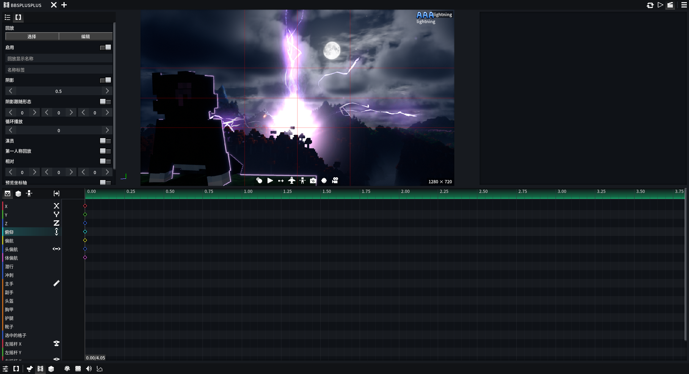
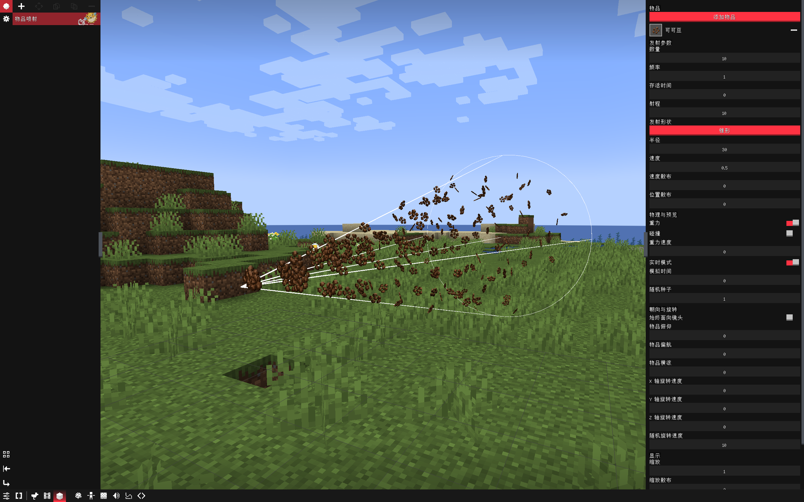
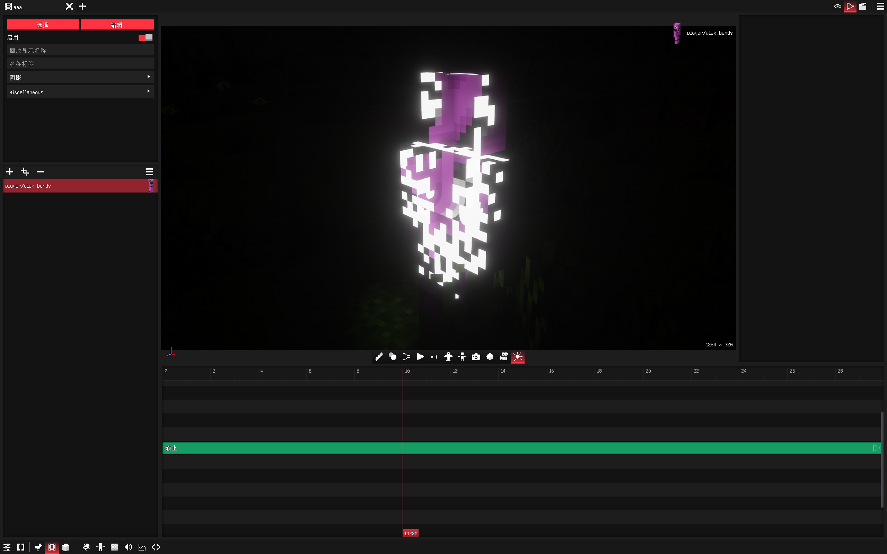

# BBS Cubed

> [BBSFS](https://github.com/Wemppy4/bbs-fs) 功能增强插件
>
> **构建状态**：1.20.1 为主发布目标，单个 JAR 兼容 1.20.1–1.20.4。1.21.11 为实验性目标，使用 Java 21。Model Morph 仅随 1.20.x 发布，AAA 粒子在 1.21.11 不可用。详见[构建与适配状态](docs/BUILD_COMPATIBILITY.md)和[项目整理计划](docs/项目整理与代码结构优化计划-3.6.9.md)。

**简体中文** | [English](README_EN.md)

  

## 功能一览

### 可配置项

| 功能 | 默认 | 说明 |
| --- | --- | --- |
| **时间轴与关键帧** | | |
| 轨道名称显示中文 | 关 | 将关键帧编辑器中的轨道名称显示为中文；可通过 `bbspp.keyframe.*` 自定义翻译。 |
| 关键帧时间不得为负 | 关 | 禁止把关键帧拖动或添加到 0 秒之前。 |
| 反转时间轴滚轮方向 | 关 | 反转 Ctrl+滚轮移动时间轴光标、Alt+滚轮移动关键帧或剪辑，以及 Alt+滚轮左右滚动时间轴的方向。 |
| Alt+滚轮时间轴模式 | 默认 | 未选中关键帧时 Alt+滚轮的行为：默认、禁用或左右滚动；选中关键帧时仍移动关键帧。 |
| 剪辑拖出顶部新建轨道 | 关 | 将整段剪辑拖出时间轴顶部时仍可创建更高的轨道。 |
| 动作自动生成起止关键帧 | 关 | 选中动作并指定动画后，自动创建相隔一个动画时长的起止关键帧，使动作片段可裁剪、循环、叠加；切换后需重新打开影片面板或模型。 |
| **姿势与动画** | | |
| Shift 直接选择父骨骼 | 关 | 在模型编辑器或回放编辑器中按住 Shift 点击模型部位时直接选中父骨骼，不弹出层级菜单。 |
| IK 目标不能选同链骨骼 | 开 | 启用时 IK 目标不能选择本 IK 链的骨骼，防止形成循环；禁用后允许选择链上骨骼，求解结果可能异常。 |
| 显示锚点变换行 | 开 | 在姿势等 XYZ 变换界面显示锚点（pivot）编辑行。 |
| 显示骨骼纹理按钮 | 开 | 在姿势编辑器中显示骨骼纹理选择按钮。 |
| 位移步长 | 0.062 | 变换界面位移行每次点按箭头或按住 Ctrl 拖动的改变量，默认约 1/16 格。 |
| 缩放步长 | 0.25 | 变换界面缩放行的改变量，与原版一致。 |
| 欧拉旋转步长 | 15 | 变换界面欧拉旋转行（角度）的改变量；四元数旋转行不受影响。 |
| 锚点步长 | 0.062 | 变换界面锚点行的改变量，默认约 1/16 格；锚点行由「显示锚点变换行」控制。 |
| 动画状态自动读取动画文件 | 开 | 打开模型方块的动画状态管理器时，从 `animations/*.animation.json` 自动创建状态；选中状态后，才在独立后台线程中烘焙姿势关键帧，并显示实时进度。切换状态时取消其他未完成任务，完成后刷新当前时间线；仅填充空状态，不覆盖手工编辑，不设关键帧数量上限。 |
| **光影** | | |
| 显示光影控制按钮 | 关 | 安装 Iris 时，在影片编辑器按钮栏右侧显示光影控制按钮；左键开关光影，右键打开光影选择界面。 |
| 世界内播放时应用光影曲线 | 关 | 使用右 Ctrl 在世界内播放影片时，曲线剪辑中的太阳、天气、天空色与 Iris 光影包参数也会生效。 |
| 光影曲线分类选择器 | 关 | 添加光影曲线时使用按光影设置分类的新界面；关闭后使用 BBS 原版平铺列表。 |
| **界面与交互** | | |
| 伪装界面双栏布局 | 关 | 伪装界面使用全新的双栏布局；关闭后恢复原版垂直布局。 |
| 影片库工作区 | 关 | 影片选择界面使用新版影片库布局与交互。 |
| 关键帧布局宽度锁定 | 关 | 关键帧编辑器布局被锁定时，同时隐藏轨道名称与曲线图之间的调节柄，不再允许调节宽度。 |
| 影片布局锁定时禁止拖动边缘 | 关 | 影片布局锁定时不响应边缘拖动。 |
| 显示快捷键冲突提示 | 关 | 按键绑定页中完全重复的按键标黄并显示叹号；悬停查看冲突功能，点击叹号跳转到对应行。 |
| 影片编辑器自动切换旁观模式 | 关 | 打开影片编辑器时自动切换到旁观模式，关闭时恢复原游戏模式。异常退出后，重新进入原单人存档时也会尝试恢复。 |
| 使用 BBS Cubed 专用剪贴板 | 关 | BBS 专用复制数据保存在内部，不写入系统剪贴板；普通文本、颜色、路径和命令复制仍使用系统剪贴板。 |
| **渲染与性能** | | |
| 自动禁用面剔除 | 关 | 为没有 `config.json` 的模型生成配置并把 `culling` 设为 `false`；已有配置的模型不受影响。 |
| 视野外停止物品渲染 | 开 | 物品喷射粒子离开玩家视野时跳过物品渲染，降低大量粒子时的帧率压力。 |
| 物品喷射最大渲染距离 | 0 | 超过该距离的物品喷射粒子跳过渲染；设为 0 时自动跟随客户端视距。 |
| 每帧最大物品渲染数 | 1024 | 限制每帧最多绘制的物品喷射粒子数量；设为 0 时不限制。 |
| IRLights 阴影最大物品数 | 1024 | 启用 IRLights 光源阴影时，限制参与投影的物品喷射粒子数量；设为 0 时禁用物品喷射投影。 |
| 回放时显示疾跑粒子 | 关 | 在回放时显示疾跑粒子效果。 |
| 流体逐骨骼精确交互 | 关 | 流体与模型逐骨骼精确交互（仅立方体模型）；关闭时按实体根位置交互，性能更好。 |
| 模型方块渲染距离 | 256 | 原版固定为 512 格；调低可减少远处模型方块的渲染与拾取开销，设为 0 时使用原版默认值。 |
| **操控器与建模** | | |
| Blockbench 程序路径 | 空 | 选择 Blockbench.exe 的位置；配置后可在伪装界面右键用户模型用 Blockbench 打开，路径未配置、无效或模型不是 `.geo.json` 时按钮置灰。 |
| 优先使用 .bbmodel 工程文件 | 开 | 模型目录下存在 `.bbmodel` 时右键优先打开它，否则打开 `.geo.json`。 |
| 操控器 T 键循环 | 关 | 在模型方块编辑器中，操控器默认平移模式；按 G/S/R 切换模式，再按一次恢复上一模式；按 T 在平移、缩放、旋转之间循环。 |
| G/S/R 使用原版切换 | 关 | 第二次按 G/S/R 不恢复上一模式，保持原版 BBS 的直接切换行为。 |
| **导出** | | |
| 导出音频文件名字幕 | 关 | 视频导出时自动生成带音频文件名的 SRT 字幕。 |
| Premiere 导出 | 关 | 在监视器最右侧显示 Premiere Pro 导出按钮，录制结束后生成 XMEML v5 XML 或 SRT。 |
| 导出独立音频片段 | 开 | 将每个 AudioClip 导出为单独的 WAV，方便在 Premiere Pro 中独立编辑。 |
| 仅音频导出 | 关 | 不录制视频，只导出独立音频与 XML/SRT 到打包文件夹。 |
| 使用 NTSC 帧率标记 | 开 | 将 24/30/60fps 标记为 NTSC 的 23.976/29.97/59.94，提高 Premiere Pro 兼容性。 |
| 导出为 SRT 字幕文件 | 关 | 生成 SRT 字幕文件代替 XML，适用于不支持 XML 导入的软件。 |

> 另有 16 个仅用于持久化的隐藏项（窗口布局比例、上次排序、面板宽度等），不显示在设置界面。

### 全新影片库

开启「影片库工作区」后，影片面板的主页会替换为影片库工作区：

- **快捷栏**：最左侧固定常用文件夹。右键文件夹选择「固定到快捷栏」，点击快捷项即可定位
- **根目录列**：快捷栏右侧始终是根目录列，根目录下可以直接新建影片
- **向右展开**：点击文件夹会在右侧新增子列，可不断向右展开；列超出可用宽度时所有列自动等比收窄，收窄到最小宽度后才横向滚动
- **每列内容**：子文件夹在上、直属影片在下，底部提供「＋ 创建影片」；拖动影片到任意文件夹行或列即可移动
- **交互**：单击选中、双击打开；右键菜单支持新建、重命名、删除、固定快捷栏；顶部保留搜索与名称排序
- 关闭开关后恢复 BBS 原版影片选择界面

### 影片编辑器时间轴锁定

- **右键锁定**：右键点击顶部切换编辑器的图标，可在菜单中「锁定时间轴 / 解锁时间轴」；锁定后工具栏图标变暗
- **只限制快捷键**：锁定不会禁用编辑器，仍可点击图标进入锁定模式；按 `·` 切换编辑器时只会经过未锁定的模式
- **按影片保存**：锁定状态随影片数据保存，不写入全局配置；切换影片或重启游戏后仍会恢复，且至少保留一个未锁定模式
- **POV 支持**：安装 BBS-POV 时，POV 编辑器同样参与锁定，并支持与摄像机/回放一致的右键「转为小窗 / 还原」

### AAA 粒子

> 前置依赖：需安装 `aaa_particles-2.2.0 ~ 2.3.4` + `architectury`，未安装则自动禁用该功能。

- 新增 AAA 粒子伪装，粒子文件需存放至 `assets/effeks/` 目录
- 触发器：可在表单关键帧中驱动 `trigger0-3`；`/bbsplusplus aaa_particle trigger <x> <y> <z> <0-3>` 在单人/集成服务器中通过本地客户端触发（远程服务器不加载本模组，指令不可用）
- 已知限制：
  - 功能已通过基础稳定性测试（无崩溃），非崩溃级问题不再维护
  - 若加载粒子后游戏崩溃，请尝试使用新版 Effekseer 重新导出粒子文件

### 物品喷射

  

- 新增物品喷射伪装，支持多种发射形状与参数调节，包括：物品、数量、频率、存活时间、射程、半径、速度、速度散布、位置散布、重力、碰撞、重力速度、实时模式、模拟时间、随机种子、始终面向镜头、物品俯仰/偏航/横滚、X/Y/Z 轴旋转速度、随机旋转速度、缩放、缩放散布、显示辅助线、颜色、发射器形状

### 粒子 Plus

- **粒子变形（Morph）**：为粒子指定一份表单，用它替换原版的贴图公告板并逐粒子绘制；可勾选静态空间，并按旋转 / 朝向等面向模式让截面始终对准镜头，同时沿用粒子自身的纹理缩放与表单缩放
- **碰撞外观与碰撞染色**：粒子撞到方块或实体后切换为指定外观，或按碰撞结果着色
- **Additive 材质**：粒子材质下拉新增「Additive」，以叠加方式混合；1.21.11 上为此自建专用渲染管线，创建失败时自动回落到普通粒子层，仅表现为叠加失效
- **另存为**：粒子编辑器可把当前方案复制为一份新文件，并直接在副本上继续编辑
- **撤销**：1.20.1 由模组提供快照式撤销，连续改动按 300 毫秒防抖合并为一条记录，支持 `Ctrl+Z` / `Ctrl+Y` 与历史面板；1.21.11 改用面板自带的撤销，两者不会叠加

### Pose 帧增强

- 支持 pose 帧多选粘贴
- 骨骼参数刷：将骨骼参数复制到另一骨骼
- 改动骨骼标识：有改动的骨骼以橙色菱形标识提示
- 跳过当前帧骨骼关键值：将鼠标移到骨骼名称右侧边缘出现菱形，点击切换。跳过后仍保留该骨骼在当前帧的参数，但动画计算忽略此关键值，直接在前后有效 Pose 帧之间插值；灰色斜线菱形表示已跳过
- 移植自 FS 2.5 的树形骨骼功能并优化显示，默认关闭

### 附魔光效

- 姿势编辑页提供「附魔光效」栏，可为选中骨骼启用原版风格的循环流光；该栏始终显示，不再由模组设置开关控制。
- 影片编辑器中，肢体轨道关键帧的属性面板同样提供「附魔光效」栏，可直接在影片时间线上按骨骼调整；姿势轨道关键帧面板中的该栏作用于当前选中的骨骼。
- 支持自定义颜色与透明度，并可调整流动速度（0–4 倍）与亮度（0–4 倍）；右键可将当前设置应用到子骨骼。
- 未启用光影时使用模组内置 shader；启用 Iris 光影后，光效改由光影包的 glint 程序绘制。两条路径共用同一相位，开关光影不会改变流速。
- 若光影包未提供 `gbuffers_armor_glint`，Iris 会回退到 `gbuffers_textured`，最终观感取决于光影包。
- 兼容说明：若已安装注册 `bbs:cinematic` 的第三方模组（如 BBS Lezy / Better Camera Perspective），本模组不覆盖该剪辑，电影效果由对方提供。

### 结构与破坏魔杖增强

> 光影曲线等能力合并自"卫巾纸薄"的 tools 插件；结构伪装本体由 BBS 2.7 内置。

- BBS 2.7 已内置结构棒与结构伪装
- 本模组补充 VFX / Xavin 破坏魔杖的选区交互、操作提示与音效（需安装对应插件）

### 视频伪装

> 前置依赖：需安装 `MediaPlayer-BBS`，未安装则自动禁用该功能，仅支持 Windows x64 平台。

- 视频文件需放入 `<游戏目录>/config/bbs/assets/video/`（支持 .mp4 / .mov / .mkv / .webm / .avi / .m4v），可通过伪装编辑器中的"选择视频"面板打开该文件夹
- 兼容说明：`MediaPlayer-BBS 1.0.1` 的 native 时间轴寻帧接口存在崩溃缺陷，BBS Cubed 会自动禁用时间轴寻帧并退回连续解码路径；`MediaPlayer-BBS 1.0.2+`（修复构建）自动启用时间轴寻帧，支持拖动播放头逐帧精确定位。修复构建发布时请将版本号升至 1.0.2 以上

### 纹理补间

  

- 在纹理关键帧之间平滑过渡，支持三种补间模式：
  - **颜色**：在两张贴图之间按进度平滑插值颜色
  - **像素溶解**：像素按块随机溶解，过渡到下一张贴图
  - **消散**：从扩散起点向外逐块消散
- 消散模式支持搭配"消散倒退"（从透明逐步恢复）与"消散闪白"（变透明前显示闪光颜色，支持自定义颜色与 LabPBR 发光）
- 可调节像素块大小、扩散强度、闪光颜色、PBR 发光亮度等参数
- 内置 3D 扩散起点拾取器：在模型表面右键直接拾取消散起点，左键旋转、中键平移、Ctrl+滚轮缩放，X/Y/Z 支持数值微调
- 兼容旧版 BBSPPP 纹理补间关键帧数据，自动迁移

### 模型描边

- 描边设置位于姿势编辑器「PBR」栏下方的可折叠「描边」栏中，按骨骼独立配置；展开后可为当前骨骼开启描边，并调整颜色、宽度、发光、面剔除与「不描边块尺寸」
- 影片编辑器中，肢体轨道关键帧的属性面板同样提供「描边」栏，可直接在影片时间线上按骨骼配置。
- 与 PBR、附魔光效一致，描边参数保存在骨骼的姿势数据中，可随关键帧插值，不再写入模型 `config.json`
- 开启后仅绘制骨骼轮廓外缘：透明贴图区域不产生描边；焊接面自动跳过；被更大方块完全包裹的小型装饰块可通过「不描边块尺寸」过滤
- 「不描边块尺寸」以模型像素为单位，`0` 表示关闭过滤；宽度以 1/4 模型像素为单位，`4` 约等于 1 个模型像素
- 右键描边开关、颜色、面剔除或任一参数滑条，选择「应用到子骨骼」，可将设置扩散到该骨骼的全部子骨骼
- 「启用描边」上方新增整行「全部应用到子集」按钮：一次把两层描边的全部参数（颜色、渐变、宽度、发光、面剔除、逐面颜色与渐变）复制给该骨骼的所有子骨骼，不必再逐项右键
- 「发光」写入 LabPBR 自发光通道：`0` 为不发光，`1`–`254` 沿该通道线性增强。它需要安装 Iris，且所用光影包声明了 `normals` / `specular` 采样器才会显现；不满足时描边仍是纯色外壳，只是没有自发光
- 「面剔除」默认开启。关闭后描边壳两侧都绘制，薄片与贴片类方块在任何角度都能看见描边，代价是顶点数翻倍
- 各层互不影响：纯色外壳始终包含全部描边骨骼，发光只在它之上叠加亮度，不会改变描边轮廓或基础颜色
- 「叠加描边」开关位于描边栏最后一行。开启后该骨骼在当前描边之外再套一层描边，并在下方展开一个与之完全对等的「描边叠加」栏：两层各有独立的颜色、宽度、发光、面剔除与逐面颜色，互不覆盖；第二层的宽度表示在里层外面再向外扩出多少，默认 `4`（1 个模型像素），两层的宽度按降序绘制，里层始终压在宽的那层之上形成双环
- 每栏底部有可折叠的「高级选项」子栏，可为前 / 右 / 后 / 左 / 上 / 下六个面单独取色；未设置过的面跟随该层主色，「全部跟随主颜色」按钮可一次把六个面交还给主色。面颜色整块取色而不参与插值，避免关键帧之间插出中间色
- 颜色行右侧图标组里的模式图标用于在「纯色」与「渐变」之间切换。纯色模式下行内只排两枚图标（模式、色块），切到渐变时才在最左侧补出「应用到子骨骼」，原色块的位置变为方向按钮并贴在色块左缘，三枚图标因此相邻；颜色行下方同时展开渐变编辑条，与左侧的色标色块之间留出间距
- 渐变编辑条左侧的色块修改当前选中色标的颜色；拖动色标调整位置，右键渐变条可新增或删除色标（至少保留一个）。色标位置与颜色随骨骼姿势保存，并写入关键帧
- 主色渐变按屏幕方向投影：上下方向沿屏幕竖直轴、左右方向沿屏幕水平轴，投影范围取模型包围盒在这两个方向上的跨度，所以无论从哪个角度看，描边都保持一整条渐变，不会在正对某个模型轴时塌成一圈纯色；相机转动时外壳会按新方向重新烘焙。逐面渐变仍按每个面的水平 / 垂直双轴投影：前、后、左、右四个面为 X / Y，上、下两个面为 X / Z，因此模型旋转后仍按该面自身的方向渐变
- 优先级为「面渐变 > 面纯色 > 主渐变 > 主纯色」：某个面单独设置了渐变或颜色时，该面不再使用主色渐变；未单独设置的面继续跟随主层
- 渐变模式下颜色行左侧的「应用到子骨骼」图标把当前渐变复制给全部子骨骼；纯色模式该图标隐藏（同一操作改用右键色块），复制时也会清除子骨骼上残留的渐变，避免子骨骼继续显示旧渐变
- 「全部跟随主颜色」在渐变模式下会同时清除六个面的渐变
- 逐面颜色同时作用于描边本体与发光层：LabPBR 自发光按面颜色分批绘制，开启光影时也不会把六个面重新刷回该层主色
- 高级选项里的每个面颜色色块都支持右键「应用到子骨骼」；「全部跟随主颜色」按钮的右键只保留「应用到子骨骼」一项（把六个面一起交还主色）
- 1.21.11 目前支持纯色与渐变描边与深度补写，LabPBR 自发光仍在适配中
- 同一面板下方的「附魔光效」栏也已合并为可折叠栏，包含光效开关、颜色、流动速度与亮度，便于与描边参数一并管理
- 迁移说明：描边不再读取模型 `config.json` 中的旧描边键；已有工程需在姿势编辑器中按骨骼重新开启，可使用「应用到子骨骼」快速铺开

### 纹理变换

- 模型形态编辑页底部提供可折叠的「纹理变换」栏，可调整贴图的 UV 偏移与缩放。
- UV 是表单级属性，与单根骨骼及其关键帧无关；影片姿势 / 肢体轨道面板不提供该栏，避免与逐骨骼数据混淆。
- 1.20.1 / 1.20.4 下，纹理变换同时应用于模型渲染 shader 与内置附魔光效 shader，开启附魔光效后 UV 调整仍然生效。

### CML 功能（合并自 bbs_snow）

> 原 bbs_snow 插件全部功能已合并进 BBS Cubed，模组 ID 统一为 `bbsplusplus`，资源命名空间 `bbspp`。安装本模组后无需再单独安装 bbs_snow。

- **流体模拟**：新增流体伪装，支持流体物理模拟渲染
- **粒子 Plus**：增强粒子系统——粒子变形（Morph）、碰撞外观与染色、收藏夹浏览器、附加渲染纹理、Additive 材质
- **PBR 纹理分级**：逐骨骼/逐组 PBR 参数覆盖（光滑度、金属度、孔隙率、自发光、法线强度）
- **骨骼纹理**：逐骨骼分配独立纹理
- **Premiere 导出**：将影片导出为 Premiere Pro XML 工程文件，同时生成 SRT 字幕文件
- **三种剪辑类型**：快捷栏剪辑、电影剪辑、重播剪辑
- **动作叠加**：每个模型表单可配置动作叠加层（actions_overlay），播放时与基础动作混合
- **动作时间线端点**：在动作轨道选中动作、选定动画后，自动在动画结束处插入成对的端点关键帧，形成可裁剪、可循环、可叠加的动作片段；由设置「动作自动生成起止关键帧」控制
- **Additive 动画**：叠加动画支持，多动作层混合计算
- **Molang 变量共享**：variable 动作模型互通开关，开启后不同动作间共享 Molang 变量
- **动画态编辑器**：动画状态编辑与布局增强，支持姿势插入
- **迷你窗口**：可停靠迷你窗口系统（影片面板、仪表盘等），支持拖拽与布局记忆
- **回放时间控制**：重播剪辑支持速度调节、反向播放、传播范围设置
- **剪辑可见性**：可临时隐藏指定剪辑
- **关键帧编辑器增强**：分割视图、嵌入检查器、动作时间线评估、PBR 关键帧工厂
- **设置面板**：独立设置模块，按功能分为时间轴与关键帧、姿势与动画、光影、界面与交互、渲染与性能、操控器与建模、导出 7 个分类

### 肢体选择

- 在伪装编辑器的模型预览中，用普通左键点击可见肢体即可选中对应骨骼。1.21.11 开启 Iris 光影或模型描边时也支持此操作。
- 按住 `E`（可在按键绑定「变换」分类改绑）进入肢体选择模式，松开立即恢复；仅在 BBS 界面内生效，文本框聚焦时自动让路。
- **左键 / 右键**：左键选中点击到的实际肢体（忽略骨骼选取覆盖），右键按骨骼选取覆盖选中。骨骼覆盖的映射放在读取拾取结果的那一刻完成，模板缓冲区停留在上一帧也不会选错骨骼。
- **新建关键帧**：动画态编辑器或影片回放面板打开时，按住期间左右键都会直接为目标骨骼新建关键帧——左键给实际肢体，右键给覆盖指向的骨骼。
- **专注显示**：按住期间隐藏操控器、坐标轴、摄像机参考线与 IK 调试层，命中框也不再绘制；模型改用原版实体着色器，并把当前选中的演员压在其他模型之前。预览地面网格与 UI 面板保持原样。
- **性能与提示**：切换着色器保留 GPU 的 VAO 渲染路径，场景里演员较多也不会掉帧；按键绑定页悬停「肢体选择」可查看分步用法。

### 原版增强

| 功能                         | 说明                                                                 |
| ---------------------------- | -------------------------------------------------------------------- |
| 动画转姿势搜索框             | 动画转姿势窗口新增动画搜索框                                         |
| 音效选择器树形列表           | 音效选择器界面以树形结构展示，便于浏览                               |
| 双击剪辑编辑                 | 时间轴上双击剪辑进入编辑界面，支持 BBS 内置剪辑及 Lezy 等 addon 提供的自定义剪辑 |
| 发光色度方块（NYK）          | 新增发光色度方块                                                     |
| IRLights 插件汉化            | IRLights 插件界面汉化                                                |
| POV 插件轨道汉化             | POV 编辑器的 HUD、手部、动作等轨道名称与「快捷栏 / 手部 / 身体附件 / POV 动作」提示随中文语言显示为中文 |
| Lezy 幻影轨道汉化            | bbs-lezy 的 illusion / illusion_transform 轨道显示为「幻影 / 幻影变换」 |
| 改进纹理管理器               | 新增网格模式与缩略图                                                 |
| vfx 插件汉化与增强           | vfx 插件界面汉化与功能增强                                           |
| 回放类别操作优化             | 支持多选拖拽、重命名类别                                             |
| 回放编辑器轨道排序解锁       | 轨道列表上方新增锁定按钮：解锁后可左键拖动轨道行调整顺序（同级同分组内，父行带子树），顺序自动保存；右键按钮恢复默认排序 |
| 预览工具栏工具收纳           | 预览窗口下方工具栏最右侧固定新增三条杠收纳按钮：悬停向上展开收纳的工具（带滑动动效），左键固定/解除固定、固定时按钮显示选中标记，右键勾选收纳哪些工具（可一键全部还原）；被收纳的工具从横条隐藏、点击镜像按钮与原按钮行为一致，设置自动保存 |
| 影片库界面重绘               | 影片库列视图贴合 BBSFS 原生卡片风格：列卡片化（投影、抬升面板与分隔描边，激活列加强调条），顶栏与底栏改下沉色带，行悬停/选中/拖放样式、横向滚动条与拖拽跟随卡片统一配色，列表底部加深色渐隐 |
| 影片库移除菜单整理           | 右键「移除文件夹」改为二级菜单：「从影片库移除」仅把文件夹从库视图收起（不动磁盘文件）；空文件夹额外提供「移除此文件夹」物理删除（带确认弹窗）；两种移除完成后自动收回展开到该文件夹的子列 |
| 撤销记录面板改进             | 撤销记录面板显示更易读的操作摘要，并扩大历史弹窗宽度                 |
| 光影曲线选择界面改进         | 改进光影曲线选择界面的交互与布局                                     |
| 屏蔽 Ctrl+B 复述功能         | 屏蔽原版 Ctrl+B 打开屏幕复述的快捷键                                 |
| 补全原版图片伪装功能         | 补全 UV 偏移                                                         |
| 光影曲线轨道名称优化         | 合并自 tools 插件                                                    |
| 日月偏角与焦点曲线关键帧     | 合并自 tools 插件                                                    |
| ItemStack 轨道改进           | 增加变换功能                                                         |
| 自动保存预设                 | 模型方块预设新增"自动保存"开关：在 IK 链、物理骨骼、骨骼限制、姿势页面的预设右键菜单开启后，参数修改经 500ms 防抖自动写入当前选中的预设，无需手动保存 |
| 自定义快捷键可配置化         | Shift+W（选择当前时间点整列关键帧）等自定义快捷键已集成到 BBS UI 按键绑定设置的"关键帧编辑器"分类中，支持自定义按键组合 |
| 肢体选择                     | 按住 E（可在按键绑定"变换"分类改绑）进入肢体选择模式：左键选实际肢体、右键按骨骼选取覆盖选，关键帧编辑器打开时左右键都会新建关键帧；按住期间临时隐藏操控器与调试叠加层，详见上方「肢体选择」 |
| 动作页列表高度               | 模型编辑器动作页的「动作」「动画」列表底边可拖动调整显示高度，双击还原，高度写入布局配置并跨界面保留 |
| 设置右键重置                 | 本模组设置页的每一项都能右键「重置数值」，包括仍为默认值、原版因此不提供该项的设置；四个变换步长、Blockbench 路径这类自定义行一并支持，重置后设置面板立即刷新 |

### 原版修复

| 功能                  | 说明                                                                                      |
| --------------------- | ----------------------------------------------------------------------------------------- |
| 输入法冲突修复        | 兼容 IMBlocker，修复 BBS 界面下无法切换中文的问题                                         |
| 曲线崩溃修复          | 修复 BBS 2.2 曲线剪辑中开启飞行模式时游戏崩溃的问题                                       |
| 飞行模式曲线修复(NYK) | 开启飞行模式后曲线关键帧的修改仍生效                                                      |
| 时间轴标尺遮挡修复    | 修复时间轴标尺遮挡导致关键帧/剪辑片段仍可被点击的问题                                     |
| 拖动剪辑片段修复      | 修复 BBSFS 中部分情况下拖动剪辑片段回弹或卡住的问题                                        |
| 播放头偏左问题修复    | 修复弹道偏左问题                                                                          |
| 模型贴图错误修复      | 修复模型贴图名称与模型名称不一致时，BBS 可能误用 `_S` 等后缀贴图作为默认模型贴图的问题     |
| 颜色膨胀问题修复      | 修复模型颜色膨胀问题                                                                      |
| 修复光影曲线          | 合并自 tools 插件，并修复 tools 存在的问题                                                |
| 屏蔽 BBS F10 黑板功能 | 屏蔽 BBS 内置 F10 黑板快捷键                                                              |
| 静音问题修复          | 修复切换音频输出设备后 BBS 静音的问题                                                     |
| 修复关键帧色条断开    | 修复相同参数关键帧色条断开的问题                                                           |
| Blockbench 步帧动画修复 | 修复 Blockbench 导出的 Bedrock 动画中 step（步阶）关键帧被当作线性插值播放的问题          |
| Bedrock 标量通道动画修复 | 修复 `"scale": 2` 这类 Bedrock 单数字简写在 BBS 中被静默丢弃、骨骼缩放动画无效的问题，统一规范化为 `[2,2,2]` |
| 穿透粒子黑屏修复 | 修复场景中存在开启「穿透渲染」的 AAA 粒子的模型方块时，打开模型方块页、影片页等编辑器预览视口出现整片纯黑或铺满方块图集的问题 |

## 代码组织

本项目的增强通过 Mixin 访问上游私有成员，为便于维护与排查，同类访问只保留一处定义：

- **单一 Accessor 定义**：`gbeic.bbsplusplus.mixin.client.accessor` 下的接口是唯一实现，并在 mixin 配置中注册；`gbeic.bbsplusplus.api` 不再保留功能重复的第二份声明，调用方统一引用 mixin 侧接口
- **同类注入合并**：目标方法与注入点完全一致的多个 Mixin 合并为一个多目标 `@Mixin`，例如模型根变换、肢体、锚点三类轨道共用的「重置变换」；不再按轨道复制实现
- **版本适配器**：两侧差异只是少量 API 改名或包路径移动时，共享源码调用版本侧的小适配器（如相机矩阵、渲染事件注册、图标矩阵、GameMode 读写），而不是在共享层写版本判断
- **构建目标分离**：`src/main/java` 为共享源码，`src/main/java-1.20.x` 与 `src/main/java-1.21.11` 存放版本专属实现，构建时按目标版本选择其一，因此同一版本目录内不应出现需要按条件排除的同名文件
- **兼容性校验**：`scripts/check-class-diff.ps1` 对比 1.20.1 与 1.21.11 两个产物，以白名单逐条登记「仅存在于某一版本」的类，只有出现未登记的缺失类才判定为回归

## 开源许可

- 本项目以 **GNU LGPL-3.0-or-later** 许可证开源，完整许可证文本见 [LICENSE](LICENSE)
- 你可以自由使用、学习、修改和分发本项目，修改后的衍生作品需同样遵循 LGPL-3.0 及其后续版本开源
- 版权所有 (C) 一阵泠风、Gbeic、snowstar
- 本项目是 [BBSFS](https://github.com/Wemppy4/bbs-fs) 的扩展插件，通过 Mixin 实现增强

### MOD 更新日志

> 历史条目中的旧分类名（BBS 增强、增强界面、CML 扩展、Gizmo 改版等）是当时版本的实际名称；当前设置已重排为 7 个功能分类，详见上方「可配置项」。

#### 3.6.9（修复与 BBS-POV 的注入冲突 + 可配置变换步长 + 动画烘焙性能）：
* **重采样动作守卫恢复生效**：BBS-POV 1.0.1 在 `Replay#applyClientActions` 中对 `ActionClip.applyClient` 挂了 `@Redirect`，而同一调用点只允许一个，本模组先前挂在该处的同点注入被静默跳过，时间重采样时的不可逆动作拦截随之失效（不报错、不崩溃）。现改为注入 `ActionClip#applyClient` 方法头，两个模组可同时生效；`require` 由 `0` 升为 `1`，签名一旦变动会在启动阶段直接报错
* **变换步长可配置**：设置面板「姿势与动画」新增位移、缩放、欧拉旋转、锚点四个步长项，默认 0.062 / 0.25 / 15 / 0.062，与原版单次点按箭头或 Ctrl 拖动一致，调整后立即生效。只改步长，四元数旋转行与普通拖动的灵敏度保持原版
* **设置右键重置**：本模组设置页每一项都能右键「重置数值」，包括仍停在默认值、原版因此不显示该项的设置与自定义行，重置后立即刷新
* **动画烘焙改为按需后台执行**：仅在选中动画状态后，才使用独立的模型、动画和 Molang 快照在后台采样，避免预加载全部动画占用内存；状态列表实时显示进度，切换状态时取消其他未完成任务，完成后在渲染线程提交并合并为一条撤销记录。取消姿势关键帧数量上限，空动画自动忽略
* **修复空动作叠加层导致 YSM 动作抽搐**：开启 `snow_actions` 后，空叠加层会被 BBS 补成默认 `idle` 动作并与 YSM 当前动作重复叠加。现仅在实际配置了动作的叠加层上创建动画器，原生 YSM 播放不再受空叠加层干扰，已有时间轴和叠加配置保持有效
* **降低烘焙与预览开销**：姿势关键帧仅保留动画涉及的骨骼，避免保存整份模型数据；模型预览按渲染帧复用光效扫描结果，减少重复骨骼遍历和临时对象创建
* **粒子 Plus 移植到 1.21.11**：粒子变形、碰撞外观与碰撞染色、Additive 材质与编辑器界面均与 1.20.1 行为一致，1.21.11 专属注入自检由 18 条增至 21 条。Additive 改为自建渲染管线——上游只提供不透明与混合两条，1.21.11 也无法临时改混合状态——创建失败时回落普通粒子层；修复预览中铺满视口的纯红矩形（坐标轴把只含旋转的 `camera.view` 当作完整相机矩阵，缺了 `camera.position` 的平移）；`sun.misc.Unsafe` 不再静态引用（Java 21 下该包不可见），改为运行时反射；源码按版本分目录，文件操作控件在 1.21.11 只保留另存为，撤销交给上游面板
* **代码整理**：合并五组重复的 `@Accessor` 声明（影片控制器、剪辑、剪辑面板、面板停靠布局、影片面板布局），每个目标只保留 `mixin.client.accessor` 下的唯一接口并统一调用方，`api` 包中功能重复的第二份声明已移除；注入方法名保持不变，对已有行为与存档无影响。模型根变换、肢体、锚点三类轨道的「重置变换」合并为一个多目标 Mixin，同时修复多选关键帧时只有主关键帧真正归零的问题。`/bbsplusplus debug` 的两个同义格式化方法合并为一个，输出文本不变。空覆盖方法与私有成员经逐条审核均有正当用途（接口抽象方法、`@Shadow` 声明、刻意留空以屏蔽原版行为、Mixin 注入处理器），未作删除；本阶段触碰的文件另外清理了内联全限定名与过时注释。`scripts/check-class-diff.ps1` 由「缺失类数量不超过基线」改为白名单精确登记，仅未登记的缺失类判为回归
* **多版本代码去重**：1.20.1 与 1.21.11 中逻辑相同的实现合并到共享源码集，版本目录只保留 API 差异。已合并物品喷射的模拟与全局渲染、分类首页布局、粒子变形与碰撞外观、自动旁观模式恢复状态五组，两侧各少一份重复实现；相机矩阵、渲染事件注册、图标矩阵与 `GameMode` 读写等差异抽成小适配器留在版本侧。剩余 24 组版本文件的差异已逐条分类为「可共享 8 组、只能部分共享 10 组、必须独立 6 组」，只登记结论、不强行合并渲染管线不同的实现
* **修复流体伪装随机抖动**：玩家伪装或影片回放选择本模组的流体时，水面会随机剧烈抖动一段时间后自行恢复，重新编辑又会复现。原因是每 tick 注入给流体的力没有上限，而扩散与耗散只在渲染帧按墙钟节流推进——回放或编辑期间帧率波动时，注入的能量超过每步耗散，振幅无界累积成「鬼畜」，直到某次重建才回落。现改为在 tick 中以固定步长推进模拟、对单格振幅设上限，并把力注入与帧率解耦，水面恢复稳定；流体的物理交互与外观参数不变
* **构建与初始化**：`build12111` 运行共享测试，Model Morph 测试随 1.20.x 运行。可选模组的注册按前置启用，1.21.11 的 Mixin 自检直接读取打包配置
* **修复 1.21.11 模型拾取**：伪装编辑器恢复普通左键选中骨骼。拾取使用与新版渲染管线匹配的顶点格式和着色器，并按贴图透明度判断命中。
* **修复 1.21.11 Iris 纹理清理异常**：调整 PBR 纹理的清理顺序，避免退出客户端或重载资源时因缓存正在被修改而中断清理。
* **修复同名存档的旁观模式恢复**：新的单人恢复记录按存档目录匹配，避免在另一份同名存档中提前触发恢复。旧格式记录仍可读取。

#### 3.6.8（移除原版辉光 + 描边与设置整理）：
* **移除原版辉光**：删除「原版辉光」开关、叠加层与相关 API，描边只保留纯色 / 渐变外壳与 LabPBR 自发光。旧存档中的 `outline_vanilla_glow` / `overlay_vanilla_glow` 键会被忽略，不影响描边本身
* **静止模型不再反复重建**：外壳缓存键对动画姿态做 1/4096 量化，IK、物理或约束求解产生的亚像素抖动不再触发整壳重建
* **渐变开销**：只有存在有效渐变层时才更新屏幕方向，纯色描边不再做矩阵求逆
* **缓存回退更可控**：外壳构建失败会记录一次日志并回退到立即渲染；深度 pass 按模型与配置精确配对，不再因单个模型错位清空整帧队列
* **设置分类重整**：设置模块由按来源或版本命名的旧分类重排为 7 个功能分类：时间轴与关键帧、姿势与动画、光影、界面与交互、渲染与性能、操控器与建模、导出；39 个可见项与 16 个隐藏持久化项全部重新归属，各分类使用独立图标
* **设置迁移兼容**：旧 `bbspp.json` 会在加载前按选项 id 迁移到新分类并保留备份，已有设置不会回落到默认值
* **设置文案整理**：按术语表统一设置名称与悬浮说明（操控器、锚点、时间轴、光影、面剔除等），开关统一写作“启用 / 禁用”；英文文案同步调整
* **锚点演员列表**：重写锚点关键帧的“选择角色”菜单，沿用影片回放顺序与回放显示名；演员较多时最多显示 10 行并支持滚动，不再超出屏幕
* **肢体选择**：原「忽略选取覆盖」快捷键升级为按住式「肢体选择」（默认 E，按键绑定“变换”分类可改绑）：左键选中实际肢体，右键按骨骼选取覆盖选中；按住期间隐藏操控器、坐标轴、摄像机参考线与 IK 调试层，模型改用原版实体着色器并压在其他模型之前；松开立即恢复，只在 BBS 界面内生效
* **肢体选择关键帧**：动画态编辑器与影片回放面板打开时，按住期间左右键都会直接为目标骨骼新建关键帧——左键给实际肢体，右键给骨骼覆盖指向的骨骼
* **肢体选择拾取**：模板缓冲区统一记录实际肢体，读取拾取结果时再按鼠标键映射骨骼覆盖，避免缓冲区滞后导致选错骨骼；表单编辑器原本右键不拾取，现由预览渲染器接管
* **肢体选择性能**：切换原版着色器时保留 VAO 渲染路径，不再退回逐顶点 CPU 变换，修正按住时的掉帧
* **肢体选择教程**：按键绑定页悬停「肢体选择」显示分步用法说明，中英文各一份
* **动作页列表高度**：动作页「动作」「动画」两个列表底边新增拖拽带（6px，骑在底边、不抢下层点击），拖动改高度、双击还原，高度写入布局配置并跨界面保留

#### 3.6.7（描边渐变 + 应用到子骨骼）：
* **描边渐变**：描边颜色行新增模式图标，可在纯色与渐变之间切换。切换为渐变时两端沿用当前颜色，画面不会立即变化；原色块的位置改为方向按钮，用于切换上下 / 左右渐变，颜色行下方同时展开渐变编辑条
* **渐变编辑条**：左侧色块修改当前选中色标的颜色，拖动色标调整位置，右键渐变条可新增或删除色标（至少保留一个）。色标位置与颜色写入骨骼姿势数据，并随关键帧保存
* **渐变投影**：主色渐变按屏幕方向投影（上下沿屏幕竖直轴、左右沿屏幕水平轴，范围取模型包围盒的跨度），任何角度看描边都是一整条渐变，不会再出现整圈纯色，相机转动时外壳按新方向重新烘焙；逐面渐变仍按每个面的水平 / 垂直双轴投影——前、后、左、右面为 X / Y，上、下面为 X / Z，模型旋转后仍按该面自身的方向渐变
* **渐变优先级**：面渐变 > 面纯色 > 主渐变 > 主纯色；某个面单独设置了渐变或颜色时，该面不再使用主色渐变
* **应用到子骨骼**：姿势编辑器颜色行新增「应用到子骨骼」图标（渐变模式下显示），把当前渐变复制给全部子骨骼并清除子骨骼残留的渐变
* **叠加与逐面联动**：叠加描边同样支持渐变；「全部跟随主颜色」会同时清除六个面的渐变；自动展开判据包含渐变设置
* **老存档兼容**：未写入渐变键的旧存档按纯色处理
* **多版本**：1.20.1 / 1.20.4 的 LabPBR 自发光改用 64×1 渐变条纹理采样，逐像素计算发光强度；1.21.11 通过顶点色实现渐变（屏幕方向投影只作用于 1.20.x，1.21.11 仍按模型空间取样）
* **全部应用到子集**：描边栏「启用描边」上方新增独占一行的文字按钮，一次把两层描边的全部参数（颜色、渐变、宽度、发光、原版辉光、面剔除、逐面颜色与渐变）复制给该骨骼的所有子骨骼，不必再逐项右键
* **颜色行排版**：纯色模式下隐藏「应用到子骨骼」图标（改由右键色块触发）；渐变模式的方向按钮贴在色块左缘，三个图标因此相邻；渐变编辑条与左侧色标色块之间加大间距，不再融成一整条
* **右键菜单精简**：「全部跟随主颜色」的右键只保留「应用到子骨骼」，移除与原按钮重复的「重置本骨骼」
* **光影下纯色描边发白修复**：纯色描边生成的 1×1 自发光纹理此前按单通道（灰度）写出，色相与发光强度一并丢失，导致开启光影（Iris）时描边被自发光 pass 冲成近白色、必须打开「原版辉光」才显色。改为按 RGBA 写出后，纯色描边在光影下直接呈现设定颜色，发光强度照常生效

#### 3.6.6（描边叠加与逐面颜色、1.21.11 渲染适配、Bedrock 步阶帧修正）：
* **发光改为 LabPBR 自发光**：原先「发光」只是一个开关，`1`–`255` 的取值不影响画面。现在它直接写入 LabPBR 自发光通道的 alpha：`0` 为不发光，`1`–`254` 线性增强，`255` 按规范保留为「不发光」而不再使用。该通道只由声明了 `normals` / `specular` 采样器的光影包读取，未启用光影时描边保持纯色外壳
* **原版辉光独立为开关**：旧版「整圈更亮」的效果拆分为独立的「原版辉光」开关，位于「发光」下方，不依赖光影，与大部分光影不兼容
* **描边分层重构**：纯色外壳始终包含全部描边骨骼，发光与原版辉光改为在其之上的叠加层，两层互不影响，开启任一层都不会改变描边轮廓或基础颜色；外壳几何缓存相应合并为单一缓冲，减少重复构建
* **面剔除开关**：新增逐骨骼「面剔除」选项，默认开启；关闭后描边壳双侧绘制，薄片与贴片类方块在任何角度都能看见描边，代价是顶点数翻倍
* **塌陷方块不再产生描边**：Blockbench 常写入的零厚度平面与线条在描边壳向外扩张后会重新获得面积，此前会在画面上留下一条细边；现在按真实包围盒判定平坦轴，只绘制确实存在面积的面
* **老存档兼容**：旧存档中「发光」为开启状态的骨骼会自动回填「原版辉光」，升级前后观感一致；关闭状态的骨骼不会凭空出现辉光
* **步阶帧判定**：此前只要关键帧带 `pre` 即判定为步阶帧，而 Blockbench 对含前值的关键帧一律写入 `pre` 与 `post`（平滑关键帧两者相同），导致平滑动画被当作步阶播放。现按动画文件中的插值声明判定：本帧 `pre` 与 `post` 不同，或上一帧声明 `easing` 为 `step`，才视为步阶帧
* **步阶帧插值**：步阶帧使用 BBS 内置的步阶插值（`CONST`），方块模型动画按段内后一帧取插值时即可正确保持前值并在该帧瞬跳
* **步阶帧之后的动画段**：动画转姿势关键帧时，步阶帧的插值曾被一并写入姿势关键帧，使离开该帧的一段同样被保持。现改为沿用下一帧的插值，离开步阶帧的段落恢复平滑
* **姿态烘焙**：同样保留步阶帧，且不会多保持一段
* 以上修正仅影响含步阶帧的动画，纯 catmullrom 与线性动画的播放不受影响
* **叠加描边**：描边栏新增「叠加描边」开关，开启后在该骨骼当前描边之外再套一层，并在下方展开对等的「描边叠加」栏。两层各有独立的颜色、宽度、发光、原版辉光、面剔除与逐面颜色，参数全部写入骨骼姿势数据并随关键帧插值；第二层宽度表示向外再扩出多少，绘制时按宽度降序，里层压在宽层之上形成双环
* **逐面颜色**：每层新增可折叠的「高级选项」子栏，前 / 右 / 后 / 左 / 上 / 下六个面可单独取色，未设置的面跟随该层主色；「全部跟随主颜色」按钮可一次复原。面颜色按整块取最近关键帧，不做插值
* **1.21.11 渲染适配**：纹理变换、纹理调色 / 白化与附魔光效在 1.21.11 上补齐渲染实现——纹理变换改在 CPU 顶点写出时应用，调色 / 白化与光效各自接管模型提交，不再只改 UI 不生效
* **1.21.11 拾取修复**：修复面板与模型编辑器预览中点不中骨骼、点中的是 gizmo 手柄以及深度缓冲未清空导致的整片未命中
* **撤销后轨道列表滚动保持**：撤销只回退数据，不再把左侧回放列表滚回顶部，也不再把关键帧编辑器的轨道列表压回最上方
* **构建产物分离**：1.21.11 专属的 mixin 配置与着色器不再进入 1.20.1 / 1.20.4 的 jar，避免低版本因类不存在而在启动阶段崩溃

#### 3.6.5（模型描边逐骨骼化 + 姿势面板收纳）：
* **描边改为逐骨骼设置**：描边参数由模型 `config.json` 迁移到骨骼姿势数据，与 PBR、附魔光效保持一致；每根骨骼可独立开启描边并设置颜色、宽度、辉光与不描边块尺寸，参数支持关键帧插值。旧 config 中的描边键不再读取，已有工程需在姿势编辑器中重新开启
* **姿势编辑器布局调整**：PBR 栏下方新增可折叠的「描边」栏；附魔光效改为独立的「附魔光效」栏，位于描边栏下方。描边与光效参数均支持右键「应用到子骨骼」
* **附魔光效重构**：附魔光效栏支持颜色、透明度、流动速度与亮度；参数写入骨骼姿势数据，支持关键帧插值
* **Iris 光影兼容**：1.20.1 / 1.20.4 在光影包接管世界绘制时，使用原版 glint 程序对同一组 VAO 二次绘制；内置 shader 与光影路径共用相位，开关光影时流速一致。未提供 `gbuffers_armor_glint` 的光影包会回退到 `gbuffers_textured`
* **设置整理**：移除 BBS++ 设置页中的附魔光效分类与开关，附魔光效栏始终显示；光效数据与渲染逻辑保持不变
* **影片轨道属性面板**：影片编辑器中，肢体轨道关键帧的属性面板在材质栏下方新增 PBR、描边、附魔光效三个折叠栏，可直接按骨骼调整；姿势轨道关键帧面板中的同类栏作用于当前选中的骨骼
* **描边渲染适配**：外壳几何按每根骨骼的描边参数构建与缓存，骨骼之间互不影响；没有开启描边的模型会跳过描边几何构建与深度补写，避免额外开销
* **描边开关同步**：重新打开姿势编辑器后，描边、附魔光效与 PBR 控件会跟随自动选中的骨骼刷新，纹理变换栏的默认展开状态同步更新；模型已渲染描边但开关显示关闭的问题不再出现
* **附魔光效颜色修复**：开启光影后，附魔光效的世界渲染颜色与编辑器颜色一致，默认白色不再偏紫
* **纹理变换栏**：模型形态编辑页新增「纹理变换」折叠栏，可调整贴图 UV 偏移与缩放，UV 参数在模型 shader 与内置附魔光效 shader 中均生效；UV 属于表单级属性，与单根骨骼及其关键帧无关，因此影片姿势 / 肢体轨道面板不提供该栏
* **纹理按钮整理**：「选择纹理…」与「骨骼纹理」按钮在模型形态编辑页顶部并排显示，骨骼纹理不再占用姿态面板底部空间
* **多版本支持**：1.20.1 / 1.20.4 与 1.21.11 同步适配

#### 3.6.4（模型描边）：
* **模型描边**：模型配置编辑器「骨骼」页新增「描边」区域，支持为整个模型设置颜色、宽度、辉光与不描边块尺寸；选中骨骼后可开启该骨骼的肢体描边并单独调整参数。全局描边关闭时，已开启的肢体描边仍会独立渲染
* **轮廓渲染**：采用与 Cool_pack 一致的负体积外壳与两段式渲染，仅保留模型轮廓外缘；透明贴图、焊接面与被大块包裹的装饰块不会产生多余描边
* **LabPBR 辉光**：1.20.1 / 1.20.4 在安装 Iris 时通过运行时生成的自发光、高光与法线纹理接入 LabPBR；未安装 Iris 或纹理不可用时回退为纯色描边
* **多版本支持**：1.20.1 / 1.20.4 完整支持描边与 LabPBR 辉光；1.21.11 支持纯色描边与深度补写，LabPBR 辉光尚在适配中
* **配置兼容**：描边设置保存在模型 `config.json` 中，键名与 Cool_pack 兼容，已有描边配置可直接读取

#### 3.6.3 hotfix（撤销后回放列表位置保持 + 动作时间线端点修复）：
* 修复影片编辑器回放轨道编辑中，撤销操作会把左侧回放列表强制滚动到顶部的问题；现在撤销只回退数据，不再移动预览位置
* 修复动作关键帧轨道（snow_actions）在动画列表中选择动画后不会重建末尾端点的问题；端点长度改为按所选动画的实际时长计算
* 修复动作在模型中没有同名动画时会插入 1 帧「假端点」的问题；现在改为不插入端点，选中动画后再生成
* 修复在一端修改动作的循环、速度、渐隐或起始 tick 后，成对端点关键帧不会同步相同设置的问题
* 设置项 snow_actions 更名为「动画轨道创建起始帧」，说明改为描述实际行为：选中动作并指定动画后自动创建起始帧与成对的结束帧

#### 3.6.3（Blockbench 步阶帧修复 + 撤销后时间轴视口保持）：
* 修复 Blockbench 导出的 Bedrock 动画中 step（步阶）关键帧在方块模型动画里被当作线性插值播放的问题；「自动读取动画文件」烘焙出的姿势轨道同样保留步阶
* 修复影片编辑器里撤销剪辑或关键帧修改后时间轴被强制拉回编辑前位置的问题；摄像机 / 动作与回放 / 关键帧编辑器的时间轴均保持撤销前的平移、缩放与轨道滚动位置

#### 3.6.2（穿透粒子导致编辑器预览黑屏修复）：
* **问题现象**：场景中存在开启了「穿透渲染」（忽略深度，X-Ray）的 AAA 粒子时，打开模型方块页、影片页等编辑器预览界面，3D 视口会整片纯黑（只显示侧栏 UI 与 gizmo），或反过来被整张方块图集铺满，且日志中没有任何报错
* **根本原因**：穿透渲染需要在主渲染流程之外额外再绘制一遍粒子。Effekseer 的 C++ 底层会绕过 Minecraft 的 `RenderSystem` 直接调用 `glActiveTexture` / `glBindTexture` 改写真实纹理绑定，`RenderSystem` 的贴图缓存因此与 GL 实际状态脱节；后续绘制认为贴图已绑定而跳过重绑，采样到空贴图或方块图集，整片视口随之变黑或铺满图集
* **状态还原**：穿透渲染段改为 `try/finally` 结构，深度范围、深度函数、深度写入、深度测试、帧缓冲绑定与视口在退出时按进入前的原值无条件还原，不再受绘制中途异常影响
* **纹理缓存校正**：退出时把 0~7 号纹理单元按 GL 的真实绑定重新经 `RenderSystem` 绑定一次（绑定值不变，仅校正缓存），既清掉 Effekseer 留下的状态，也不再出现"清空绑定导致全黑、回滚绑定导致图集铺屏"的问题
* **兼容性**：修复位于穿透渲染的独立绘制段，不影响 AAA 粒子本身的显示、穿透效果与透明排序

#### 3.6.1（影片编辑器时间轴锁定 + 轨道名称汉化 + 适配 AAA Particles 2.3.4）：
* **时间轴锁定**：右键顶部编辑器图标可「锁定时间轴 / 解锁时间轴」；锁定后图标变暗，`·` 切换快捷键只在未锁定模式间循环，但仍可手动点击图标进入锁定模式
* **按影片保存**：锁定状态随影片保存，切换影片或重启后自动恢复；至少保留一个未锁定模式
* **POV 编辑器小窗**：POV 编辑器支持与摄像机/回放一致的右键「转为小窗 / 还原」
* **POV 轨道汉化**：POV 编辑器的 HUD、手部、动作等轨道名称与「快捷栏 / 手部 / 身体附件 / POV 动作」提示文本随中文语言显示为中文
* **Lezy 幻影轨道汉化**：bbs-lezy 提供的 illusion / illusion_transform 轨道显示为「幻影 / 幻影变换」
* **兼容 AAA Particles 2.3.4**：适配 AAA Particles 最新版 2.3.4，特效加载与注入、卸载清理、帧缓冲捕获、X-Ray 穿透渲染等接口均保持可用，模块自身代码无需改动
* **放宽版本上限**：模组冲突检查由「高于 2.2.3 拒绝启动」放宽为「高于 2.3.4 拒绝启动」，安装 2.2.0 ~ 2.3.4 任意版本均可与本模组共存
* **内置编译依赖**：2.3.4 尚未发布到 Modrinth 仓库，改为随仓库携带 `libs/aaa_particles-fabric-1.20.1-2.3.4.jar` 作为编译与开发运行依赖，文件缺失时自动回退到 Modrinth 坐标
* **整理开发环境**：移除 `run/1.20.1/mods` 中重复的 AAA Particles 模组文件，开发运行时统一由构建提供，避免同名模组重复加载
* **多版本回归**：1.20.1 / 1.20.4 / 1.21.11 三个构建目标均编译通过（1.20.4 与 1.21.11 仍仅在编译期引用 AAA Particles）

#### 3.6.0（影片库横向折叠列 + 快捷栏 + 轨道排序解锁 + 工具收纳）：
* **预览工具栏工具收纳**：预览窗口下方工具栏最右侧固定新增三条杠「工具收纳」按钮：悬停向上展开收纳的工具（带滑动动效，移开自动收起），左键固定/解除固定、固定时按钮显示选中标记，右键弹出清单勾选收纳哪些工具、可一键全部还原；被收纳的工具从横条隐藏、横条自动重新居中，展开栏里的镜像按钮与原按钮的图标（含播放/暂停等动态图标）、左键动作和右键菜单完全一致；开启「自动隐藏」时悬停展开栏也算工具栏的一部分；收纳状态自动保存，重新打开影片编辑器自动恢复
* **回放编辑器轨道排序解锁**：轨道列表左下按钮列（「展开/折叠所有分组」上方）新增锁定按钮，图标实时显示闭锁/开锁状态；解锁后可在名称列左键按住轨道行拖动重排，拖动时显示插入位置指示线，松手即自动保存顺序，切换分类/回放或重启游戏后依然生效；限定同级同分组内移动，拖父行时整个子树跟随；右键按钮可「恢复默认排序」；普通点击轨道行的插关键帧、折叠切换行为不受影响
* **移除右侧影片列表**：影片库不再保留独立的右侧列表，影片与子文件夹全部位于各自的列中
* **向右无限展开**：点击文件夹在右侧新增子列，可逐级展开；列超出可用宽度时所有列自动等比收窄，最小宽度后再横向滚动
* **快捷栏**：最左侧新增快捷栏，右键任意文件夹可固定/取消固定，点击快速定位到该文件夹
* **影片库界面重绘**：列视图贴合 BBSFS 原生卡片风格——列卡片化（投影、抬升面板与分隔描边，激活列加强调条），顶栏与底栏改下沉色带，行悬停/选中/拖放样式、横向滚动条与拖拽跟随卡片统一配色，列表底部深色渐隐
* **动效**：列宽缩放与横向滚动使用平滑缓动，保持 BBSFS 原生配色与行高
* **1.21.11 适配**：以上改动同步支持 Minecraft 1.21.11

#### 3.5.9（全新影片库重做）：
* **影片库主页**：开启「影片库工作区」后，影片面板的 Landing 主页替换为影片库工作区，左侧为「全部影片」与文件夹树，右侧为影片列表；搜索、排序与默认打开位置和原影片列表浮窗共用同一份状态
* **双击打开影片**：影片列表改为单击选中、双击打开，避免单击误开影片
* **拖拽移动影片**：可将影片行拖到左侧文件夹（含根目录）完成移动，拖动时目标文件夹会高亮；支持多选批量移动，目标位置已有同名影片时自动跳过
* **文件夹管理**：支持新建、重命名、删除文件夹，以及在指定文件夹新建影片；文件夹与「全部影片」均可右键设为默认打开位置，默认项以星标标识
* **复用原版复制/粘贴**：移除影片列表自定义的「复制」菜单项，直接使用 BBS 原版剪贴板
* **修复列表右键菜单崩溃**：BBS 专用剪贴板不可用时自动回退系统剪贴板，避免打开列表右键菜单时因类加载失败导致游戏崩溃
* **修复可见性按钮**：影片库主页等未打开影片的场景下，可见性按钮置灰且不可点击，F5 不再弹出可见性菜单
* **1.21.11 适配**：影片库重做同步支持 Minecraft 1.21.11，1.20.1 / 1.20.4 / 1.21.11 构建均通过

#### 3.5.8（Gizmo T 键循环 + 忽略选取覆盖快捷键）：
* **新增 Gizmo T 键循环**：设置 → Gizmo 改版 中新增"T键循环"开关（默认关闭）。开启后模型方块编辑器的 Gizmo 默认平移模式；按 G/S/R 切换到对应操作模式，再按一次恢复上一模式；按 T 键在 平移→缩放→旋转 之间循环切换
* **新增 G/S/R 保持原版切换**：开启后第 2 次按 G/S/R 不恢复上一模式，保持原版 BBS 的直接切换行为
* **新增忽略选取覆盖快捷键**：模型编辑器中按住 E（可在按键绑定"变换"分类中改绑）点击肢体时，跳过骨骼选取覆盖重定向，直接选中实际点击的骨骼；该按键仅做被动检测，不消费输入事件，可与其他功能同时触发
* **修复 AAA 粒子伪装穿透渲染在影片回放预览中黑屏/消失**：开启"穿透渲染"后，影片回放预览与导出使用自定义尺寸帧缓冲，而独立 X-Ray 管理器未像全局管理器那样绑定背景色与深度附件，导致粒子落到默认帧缓冲，预览全黑或粒子不可见。现已在自定义尺寸语境下显式复刻全局管理器的 `SetBackground`/`SetDepth` 绑定，并跳过与原生主 FBO 尺寸错配的深度缓冲备份/恢复，预览与导出中粒子可正常穿透方块显示且不污染画面；真实世界的穿透行为保持不变
* **修复装有 IRLite 1.0 时客户端启动崩溃**：IRLite 1.1.x 给 `renderGuide` 追加了 `boolean guideVisible` 参数，3.5.1 起本模组的注入回调跟着改成三参，只按方法名匹配时 Mixin 仍会先找到旧版两参方法再做描述符校验，直接抛 `InvalidInjectionException` 让整个客户端在初始化阶段崩掉（`require = 0` 拦不住）。现在按版本拆成两个注入器并各自写完整描述符，IRLite 1.0 与 1.1.x 都能正常启动，导引线/模具手柄的隐藏行为保持不变

#### 3.5.7（肢体面剔除 + 姿势面板布局优化 ）：
* **新增肢体面剔除开关**：模型配置编辑器骨骼面板中新增"肢体面剔除"开关，可按骨骼单独控制是否开启面剔除，优化远处模型渲染性能
* **姿势面板布局调整**：姿势编辑页中 PBR 折叠栏与骨骼纹理按钮从面板底部移至材质栏正下方，布局更紧凑直观
* **动作状态自动读取动画文件**：动作状态编辑器选中动画后自动解析同目录 `model.animation.json`，读取 loop 字段并烘焙姿态轨道

#### 3.5.6（动画悬停预览 + 退出世界崩溃修复 + 快捷键冲突提示）：
* **新增动作编辑器动画悬停预览**：模型编辑器"动作"页动画列表中，鼠标停在动画条目上时从该条目下方弹出正方形预览栏，循环播放对应动画；预览栏按模型包围盒自动缩放填满，仅作预览不影响编辑
* **修复退出/切换世界时 JVM 崩溃**：退出世界时 BBS 会在 Netty 客户端 IO 线程上直接调用 `glDeleteTextures` 等 OpenGL 函数释放视频纹理，而该线程没有当前 GL 上下文，导致 LWJGL 抛出 "No context is current" 并直接终止 JVM。现已将视频资源删除、影片控制器关闭、相机重置等 GL 清理操作统一调度回渲染线程执行，退出世界不再崩溃
* **修复 Bedrock 单数字缩放动画无效**：修复 `"scale": 2` 这类 Bedrock 简写在 BBS 中被忽略、骨骼缩放没反应的问题；现在单值会自动按三轴同值处理，`"position": 0.5`、`"rotation": 90` 等同理支持
* **新增快捷键冲突提示开关**：BBS 增强中新增"快捷键冲突提示"（默认关闭）。开启后，按键绑定设置页中完全重复的按键会以黄色字体显示，按键框左侧出现黄色叹号；悬停叹号列出所有共用此按键的功能，点击叹号自动跳转到冲突所在行（同分类滚动定位，跨分类自动切换分类并滚动到位）；左右 Shift/Ctrl/Alt 视为等效
* **调整"与上一个镜头模式循环"默认键位为 Q**：从原 R 改为 Q，避免与原版 R 键冲突；已有自定义键位的存档不受影响

#### 3.5.5（IK 目标可选 + BBS 2.7 伪装注册修复）：
* **新增 IK 目标约束开关**：BBS 增强中新增"IK 目标约束"选项（默认开启）。开启时保持原版行为，IK 目标不能选择本 IK 链自身骨骼以避免循环；关闭后允许选择链上骨骼作为 IK 目标，可用于连锁或循环约束
* **修复 snow_actions 伪装飞行动作鬼畜**：恢复动作时间线帧传播，并移植防抖修复线，飞行、飞行待机、游泳、骑乘等状态动作连续播放，非循环动作不再出现 fadeOut 弹跳
* **修复 BBS 2.7 下 AAA 粒子与物品喷射伪装从伪装页消失**：BBS 2.7 调整资源重载时序后，启动期反射注入到额外分类的伪装表单会被重建冲掉；改为在每次分类重建时统一挂载 FluidForm、AAAParticleForm、ItemSprayForm
* **修复自动保存预设按钮视觉状态不同步**：右键菜单中"自动保存"按钮的图标颜色随开关状态同步（关 = 灰、开 = 白）；未选中预设时自动回退到当前参数匹配的预设或第一个预设

#### 3.5.4（物理化修复 + Lezy 相机效果汉化）：
* 修复物理化肢体不跟随线框移动的问题
* 修复 snow_actions 飞行动画抽搐问题
* snow_actions 默认关闭，需在设置中手动开启
* 补全 Lezy 相机效果片段（调色、电影感、黑边、暗角）关键帧轨道名汉化
* 支持双击 BBS 内置剪辑及第三方 addon（如 Lezy）提供的剪辑进入关键帧编辑

#### 3.5.3（撤销重做 + Premiere 导出修复）：
* 模型方块预览主页新增撤销/重做支持（Ctrl+Z / Ctrl+Y），连续快速修改自动合并为一步
* 修复影片编辑器 F5 可见性菜单失效问题，并改为可绑定快捷键
* 修复撤销/重做后位置、旋转、缩放等输入框数值与实际状态不一致的问题
* 修复 Premiere 导出 WAV 音频爆音、杂音与破音问题
* 修复多选关键帧后执行重置会影响全部选中关键帧的问题，现仅重置主关键帧
* Premiere 导出按钮随设置实时显隐，无需重进游戏

#### 3.5.2（姿势 PBR 栏 + 适配 BBS 2.7）：
* 姿势编辑页新增 PBR 折叠栏，支持光泽度、金属度、次表面散射、自发光、凹凸五项参数（默认折叠）；影片编辑器中姿势轨道与肢体轨道同步加入
* 姿势页材质栏颜色右键菜单改为列表式，并新增"调色卡"选项
* 适配 BBS FS 2.7：修复 tick 浮点化、overlay 拆分、失效 reset 重定向，新增 UnknownFormRenderer

#### 3.5.1（IRL 汉化补全）：
* 补全 IRLights 1.1.7 全部界面文字与轨道名汉化
* 修复 IRL 1.1.7 方法变动导致的兼容性问题

#### 3.5.0（适配 BBSFS 2.6）：
* 适配 BBSFS 2.6，修复启动崩溃与渲染问题
* 补全新增材质、IK、物理、骨骼约束等轨道的名称汉化
* 修复新版 BBS 渲染流程变更导致隐藏伪装形态功能失效的问题
* 纹理补间像素溶解效果新增闪白与发光支持

#### 3.3.3：
* 伪装页模型右键新增"用 Blockbench 编辑"：在 设置→增强界面 选择 Blockbench.exe 路径后，右键用户模型即可在 Blockbench 中打开；模型目录下存在 `.bbmodel` 工程文件时优先使用，否则打开 `.geo.json`（可在设置中开关）。路径未配置/无效或非 `.geo.json` 模型时按钮置灰，BBS 内置模型不显示该按钮
* 影片编辑器新增 `R` 键在当前与上一个镜头模式间循环切换；轨道控制器为常驻成员，切回后保留相机角度、距离与绑定实体
* 关键帧轨道汉化补全：补齐快捷栏物品槽、速度 vX/vY/vZ、VFX 增强、流体、PBR、摄像机 Clip、Mob、物品喷射等轨道的中英文名称

#### 3.2.2：
* 新增附魔光效（未完成）：姿势编辑页可为骨骼添加原版风格附魔流光，支持自定义颜色、透明度及右键应用到子骨骼（Iris 光影下暂不显示）
* AAA 粒子修复：修复深度状态污染导致编辑器预览黑屏，新增无贴图模型兜底渲染，清理模块死代码
* 性能优化：模型方块打开卡顿优化——Dashboard 空闲预热、VAO 烘焙分帧执行、UI 调色板缓存、Gizmo 静止跳过重绘、渲染距离可配置、全局开关不再整世界 reload
* 快捷键可配置化：Shift+W（选择当前时间点整列关键帧）已集成到 UI 按键绑定设置的"关键帧编辑器"分类中，支持自定义修改

#### 3.2.1：
* 补全 605 个关键帧轨道英文翻译，修复英文语言下轨道名仍显示中文的问题
* 修复跟随轨道菜单硬编码中文，语言检测优先使用 BBS 自身设置

#### 3.2：
* 伪装界面改进：支持列表/网格模式切换，Ctrl+滚轮缩放图标，拖拽模型到分类文件夹可移动文件
* 修复 Blockbench Bedrock 动画 step（步阶）关键帧被当作线性插值播放的问题

#### 3.1.1：
* 移除姿势编辑器纹理调色/美白功能
* 修复 OrbitViewGizmo 在原版轨道模式下被误隐藏的问题
* 跟随轨道模式新增右键菜单支持；hotfix 修复 Mixin BOM 导致启动崩溃

#### 3.1：
* 合并 bbs_snow（CML）全部功能：流体模拟、粒子 Plus、PBR 纹理分级、骨骼纹理、Premiere 导出、三种剪辑类型、动作叠加、Additive 动画、迷你窗口等
* 设置面板重构为独立模块，分类整合为 BBS 增强、增强界面、物品喷射、Gizmo 改版、CML 扩展、导出增强
* 跟随轨道支持 XYZ 轴方向选择

#### 3.0：
* 展示名由 BBS++ 更名为 BBS Cubed，合作版本

#### 2.7.2：
* 预设自动保存性能优化：序列化防抖、后台线程写盘、内容比对跳过无效写入

#### 2.7.1：
* 新增模型方块预设自动保存：IK 链/物理骨骼/骨骼限制/姿势页面右键开启，500ms 防抖自动写入

#### 2.7：
* 合并 BBSPPP 全部功能：纹理补间（颜色/像素溶解/消散）、3D 扩散起点拾取器、音频字幕导出
* 设置界面重构为独立模块

#### 2.6.3：
* 新增视频伪装（依赖 MediaPlayer-BBS，仅 Windows x64）
* 补全 IRLights 汉化，修复 vfx 着色器报错及与物品喷射的冲突

#### 2.6.x：
* Pose 帧增强：骨骼参数刷、改动骨骼橙色标识、跳过当前帧关键值、多选粘贴、树形骨骼列表
* 改进破坏魔杖操作体验，修复关键帧色条断开问题
* 增加音频输出设备切换监听，避免切换设备后静音

#### 2.5.x：
* 合并 tools 插件：结构伪装、光影曲线修复、日月偏角曲线关键帧
* 全新影片库界面、BBS 专用剪贴板、Alt 滚轮时间线行为
* AAA 粒子窗口可拖动调整大小及持久化，允许扩展剪辑轨道
* 适配 BBSFS 2.4，补全图片伪装 UV 偏移

#### 2.4.x：
* 新增物品喷射伪装，支持多种物品与发射形状，持续优化阴影与碰撞
* 新光影曲线选择界面，世界播放应用光影曲线
* 改进撤销记录面板，支持设置最大撤销步数

#### 2.3.x：
* 新增光影控制按钮（影片编辑器内开关/选择光影）
* 修复剪辑拖动回弹、播放头偏左弹道问题
* 纹理管理器增加网格模式，ESC 可取消快捷键
* vfx 插件汉化
