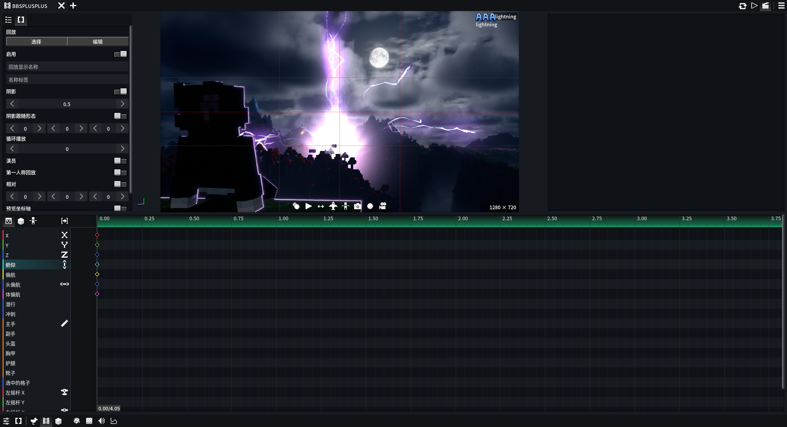
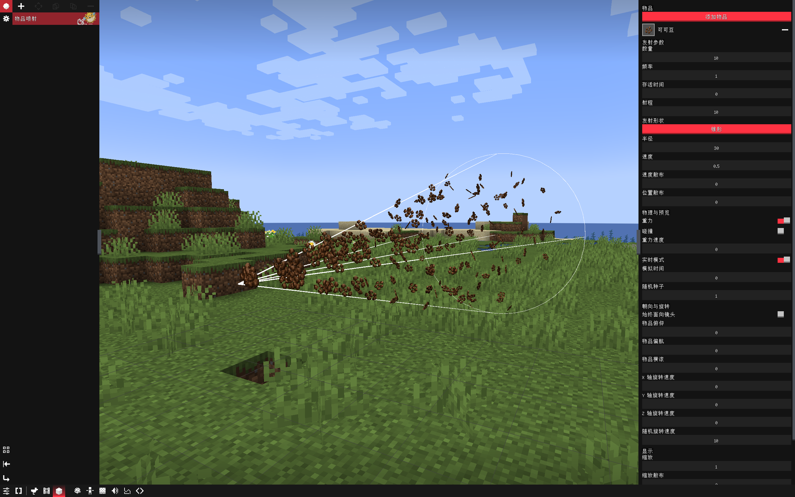
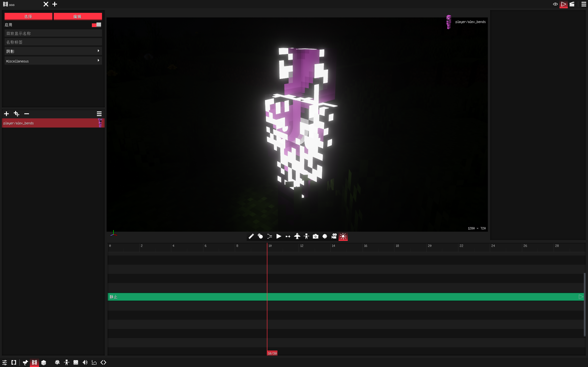

# BBS Cubed

> An enhancement plugin for [BBSFS](https://github.com/Wemppy4/bbs-fs)
>
> **Build status**: 1.20.1 is the primary release (single jar compatible with 1.20.1–1.20.4); 1.21.11 is experimental — roughly 20% of the rendering / UI / third-party plugin integration code is not ported yet (excluded at build time).

**[English]** | [简体中文](README.md)

  

## Feature Overview

### Configurable Options

| Feature                      | Default | Description                                                                                                                                                                                                                    |
| ---------------------------- | ------- | ------------------------------------------------------------------------------------------------------------------------------------------------------------------------------------------------------------------------------ |
| **BBS Enhancements**         |         |                                                                                                                                                                                                                                |
| Chinese keyframe track names | Off     | Displays keyframe editor track names in Chinese. Translations can be added/modified via the language file `bbspp.keyframe.*`, with a hardcoded table as fallback                                                                |
| Auto-switch to spectator in editor | Off | Automatically switches to spectator mode when opening the movie editor and restores the previous mode on close                                                                                                                |
| Disallow negative keyframes  | Off     | Prevents dragging or adding keyframes before 0 seconds in the keyframe editor                                                                                                                                                   |
| Shift directly selects parent | Off    | Holding Shift and clicking a model part in the replay or model editor selects the parent bone directly, skipping the hierarchy menu                                                                                            |
| Pose bone tree list          | Off     | Indents the pose editor bone list by parent-child hierarchy with tree connector lines; search results remain flat                                                                                                             |
| First-person view sway       | Off     | Restores the vanilla walking view sway while playing first-person replay                                                                                                                                                        |
| New disguise interface layout | Off    | Uses the new two-column disguise layout; when off, the original vertical layout is used                                                                                                                                        |
| New movie library interface  | Off     | Replaces the movie panel home with shortcuts + root column + expanding child columns; supports double-click, drag to move, search, and sorting |
| Reverse timeline scroll direction | Off | Reverses scroll-wheel timeline direction in the movie editor, including Ctrl+scroll (playhead), Alt+scroll (selected keyframes/clips), and Alt+horizontal-scroll                                                                 |
| Shader control button        | Off     | Adds a button in the movie editor: left-click toggles shaders, right-click opens the shader picker                                                                                                                            |
| New shader curve selection UI | Off    | When adding shader curves in curve clips, uses a categorized UI based on shader settings; when off, uses the vanilla flat list                                                                                                |
| Blockbench executable path   | Empty   | Path to Blockbench.exe, used when opening user models from the disguise panel                                                                                                                                                  |
| Prefer .bbmodel              | On      | Right-click opens the `.bbmodel` project when present; otherwise opens `.geo.json`                                                                                                                                             |
| Keyframe layout deep lock    | Off     | When the keyframe editor layout is locked, the width splitter between track names and tracks is also hidden, preventing width adjustment                                                                                     |
| World playback applies shader curves | Off | While playing movies in-world via right Ctrl, sun/weather/sky-color and Iris shader pack parameters from curve clips also take effect                                                                                        |
| Allow dragging to extend clip tracks | Off | Dragging a clip above the top of the timeline no longer restricts track hierarchy, allowing additional tracks like vanilla BBS                                                                                                 |
| Use BBS Cubed dedicated clipboard | Off  | BBS-specific copy data (replay, keyframes, form, transforms) stays inside BBS Cubed and is not written to the system clipboard                                                                                                |
| Alt+scroll timeline behavior | Default  | Behavior of Alt+scroll in the keyframe view when no keyframe is selected                                                                                                                                                       |
| IK target cycle constraint   | On      | When on (vanilla behavior), IK targets cannot be bones on the same IK chain (prevents cycles). When off, chain bones may be selected as IK targets; solver results may be unstable, use at your own risk                         |
| **Item Spray**               |         |                                                                                                                                                                                                                                |
| Skip off-screen rendering    | On      | Item spray particles skip rendering when outside the player's view, reducing frame-rate pressure with large particle counts                                                                                                   |
| Max render distance          | 0       | Item spray particles beyond this distance skip rendering; 0 follows the client render distance automatically                                                                                                                   |
| Max render count per frame   | 1024    | Maximum item spray particles drawn per frame; 0 disables the limit                                                                                                                                                             |
| IRL shadow max item count    | 1024    | Maximum item spray particles participating in IRLights light shadows; 0 disables item spray shadow                                                                                                                              |
| **Performance Optimization** |         |                                                                                                                                                                                                                                |
| Model block render distance  | 0       | Vanilla defaults to 512 blocks. Lowering this reduces rendering and picking overhead for distant model blocks; 0 uses the vanilla default                                                                                     |
| **Gizmo Modifications**      |         |                                                                                                                                                                                                                                |
| T-key Cycle                  | Off     | When enabled, Gizmo defaults to translate mode. Press G/S/R to switch to that mode, press again to restore the previous mode. Press T to cycle translate → scale → rotate                                                  |
| Keep Original G/S/R          | Off     | When enabled, pressing G/S/R a second time does not restore the previous mode, keeping vanilla BBS direct-switch behavior                                                                                                    |

### New Movie Library

When "New movie library interface" is enabled, the movie panel home is replaced by a library workspace:

- **Shortcuts**: the leftmost column pins frequently used folders. Right-click a folder and choose "Pin to Shortcuts"; click a shortcut to jump to it
- **Root column**: the column next to the shortcuts is always the root folder, where movies can be created directly
- **Expand to the right**: clicking a folder adds a child column to the right, and this can continue indefinitely; when columns exceed the available width they all shrink proportionally, and horizontal scrolling starts only after reaching the minimum width
- **Column contents**: subfolders on top, direct movies below, with a "+ Create Film" footer. Drag a movie onto any folder row or column to move it
- **Interaction**: single-click selects, double-click opens; the context menu supports create, rename, delete, and pin; search and name sorting stay at the top
- Disabling the option restores BBS's original movie selection interface

### AAA Particles

> Prerequisites: requires `aaa_particles-2.2.x` + `architectury`; the feature auto-disables if they are not installed.

- Adds AAA particle disguise; particle files must be placed under `assets/effeks/`
- Triggers: drive `trigger0-3` from form keyframes; the `/bbsplusplus aaa_particle trigger` command is still experimental (server broadcast is not implemented yet, so it does not actually fire)
- Known limitations:
  - The feature has passed basic stability testing (no crashes); non-crash issues are not maintained further
  - If the game crashes after loading particles, try re-exporting them with a newer version of Effekseer

### Item Spray

  

- Adds an item spray disguise with multiple emitter shapes and adjustable parameters: item, count, frequency, lifetime, range, radius, speed, speed spread, position spread, gravity, collision, gravity speed, realtime mode, simulation time, random seed, always face camera, item pitch/yaw/roll, X/Y/Z rotation speed, random rotation speed, scale, scale spread, guide lines, color, emitter shape

### Pose Frame Enhancements

- Multi-select paste for pose frames
- Bone parameter brush: copies parameters from one bone to another
- Modified-bone indicator: modified bones show an orange diamond marker
- Skip current-frame bone key value: hover over the right edge of a bone name and click the diamond to toggle. Skipping retains the bone's parameters on the current frame but animation interpolation ignores them, blending directly between the surrounding valid pose frames; a gray hatched diamond indicates a skipped bone
- Tree bone list ported from FS 2.5 with optimized rendering; off by default

### Enchant Glint

- The pose editor adds an "Enchant Glint" toggle per selected bone, providing a vanilla-style looping glint with no seams
- A "Glint color" picker below the toggle customizes the glow color; white matches vanilla, and the alpha slider dims the effect
- Right-click the toggle or picker to choose "Apply to children", propagating the state to all descendant bones (including unedited ones)
- Known limitation: the glint does not render while an Iris shader pack is active (it works with shaders off and in the editor preview). This is a fundamental compatibility limitation of Iris regarding mod-provided core shaders; see `docs/development/compatibility/core-shaders.md`

### Structure & Destruction Wand Enhancements

> Shader-curve features are merged from the `tools` plugin by "卫巾纸薄"; the structure disguise itself ships with BBS 2.7.

- BBS 2.7 already includes the structure wand and structure disguise
- This mod adds selection interaction, hints and sounds for the VFX / Xavin destruction wand (requires the corresponding plugin)

### Video Disguise

> Prerequisite: requires `MediaPlayer-BBS`; the feature auto-disables otherwise. Windows x64 only.

- Place video files under `<game directory>/config/bbs/assets/video/` (.mp4 / .mov / .mkv / .webm / .avi / .m4v). The folder can be opened from the "Select Video" panel in the disguise editor
- Compatibility: `MediaPlayer-BBS 1.0.1` has a crash defect in its native timeline frame-seeking API; BBS Cubed automatically disables frame seeking and falls back to continuous decoding. `MediaPlayer-BBS 1.0.2+` enables frame seeking automatically for sample-accurate seeking while dragging the playhead. Bump the version to 1.0.2 or higher when publishing the fixed build

### Texture Tweening

  

- Smooth transitions between texture keyframes, with three modes:
  - **Color**: interpolates colors between two textures by progress
  - **Pixel dissolve**: pixels dissolve in random blocks to the next texture
  - **Dissipate**: dissipates block by block outward from the spread origin
- Dissipate mode supports "dissipate reverse" (fade back from transparent) and "dissipate flash" (show a flash color before becoming transparent, with custom color and LabPBR emission)
- Adjustable pixel block size, spread strength, flash color, and PBR emission brightness
- Built-in 3D spread-origin picker: right-click the model surface to pick the origin; left-drag rotates, middle-drag pans, Ctrl+scroll zooms; X/Y/Z can also be numeric fine-tuned
- Automatically migrates legacy BBSPPP texture tween keyframe data

### CML Features (merged from bbs_snow)

> All features of the original `bbs_snow` plugin have been merged into BBS Cubed. The mod ID is unified as `bbsplusplus` with resource namespace `bbspp`. After installing this mod, bbs_snow need not be installed separately.

- **Fluid simulation**: fluid disguise with fluid physics simulation rendering
- **Particle Plus**: enhanced particles — morph, collision appearance and tinting, favorites browser, additional render textures, Additive materials
- **PBR texture tiering**: per-bone/per-group PBR overrides (smoothness, metalness, porosity, emission, normal intensity)
- **Bone textures**: independent texture assignment per bone
- **Premiere export**: exports movies as Premiere Pro XML projects alongside SRT subtitle files
- **Three clip types**: hotbar clips, movie clips, and replay clips
- **Action overlay**: each model form can configure overlay action layers (`actions_overlay`) blended with base actions during playback
- **Additive animation**: overlay animation support with multi-layer blending
- **Molang variable sharing**: interop toggle for variable action models; when on, Molang variables are shared across actions
- **Animation state editor**: animation state editing with enhanced layout and pose insertion
- **Mini windows**: dockable mini-window system (movie panel, dashboard, etc.) with drag and layout memory
- **Replay time control**: replay clips support speed adjustment, reverse playback, and propagation range
- **Clip visibility**: temporarily hide specific clips
- **Keyframe editor enhancements**: split view, embedded inspector, action timeline evaluation, PBR keyframe factory
- **CML settings panel**: independent settings module with General, Appearance, Editor, Display, Fluid Simulation, Model Block, Pose Track Selection, Replay Editor, and other categories

### Vanilla Enhancements

| Feature                            | Description                                                                                                                                       |
| ---------------------------------- | ------------------------------------------------------------------------------------------------------------------------------------------------- |
| Animation-to-pose search box       | Adds an animation search box to the animation-to-pose window                                                                                     |
| Sound selector tree list           | Sound selector shown as a tree for easier browsing                                                                                               |
| Double-click clip to edit          | Double-clicking a clip on the timeline opens its editor; supports both BBS built-in clips and addon-provided clips such as Lezy                     |
| Glowing chroma block (NYK)        | Adds a glowing chroma block                                                                                                                      |
| IRLights plugin localization       | Localization of the IRLights plugin                                                                                                              |
| Improved texture manager           | Adds grid mode and thumbnails                                                                                                                     |
| vfx plugin localization & enhancements | Localization and enhancements for the vfx plugin                                                                                             |
| Replay category operations         | Multi-select drag and category renaming                                                                                                           |
| Replay editor track order unlock   | The track list gains a lock button above it: unlock to drag track rows into a new order (within the same level and group, parent rows carry their subtree); the order is saved automatically; right-click the button to restore the default order |
| Preview toolbar tool overflow      | A hamburger overflow button is fixed at the right end of the toolbar below the preview window: hovering expands the stowed tools upward (with a slide animation), left-click pins/unpins (pinned shows a selection marker), right-click chooses which tools to stow (one-click restore all); stowed tools are hidden from the bar and their mirror buttons behave exactly like the originals; the state is saved automatically |
| Movie library interface rework     | The library column view now matches the BBSFS native card style: card-like columns (drop shadow, raised panel and divider outline, accent bar on the active column), sunken top/bottom bars, unified row hover/selection/drop styling, horizontal scrollbar and drag-follow card colors, and a dark fade at the bottom of lists |
| Movie library remove menu          | Right-click "Remove folder" now opens a submenu: "Remove from library" only hides the folder from the library view (files untouched); empty folders additionally offer "Remove this folder" for physical deletion (with confirmation); after either removal the columns expanded into that folder collapse automatically |
| Undo history panel improvement     | More readable operation summaries; wider history popup                                                                                            |
| Shader curve selection UI          | Improved interaction and layout of the shader curve picker                                                                                        |
| Disable Ctrl+B screen reader       | Blocks the vanilla Ctrl+B screen-recap shortcut                                                                                                   |
| Complete vanilla image disguise    | Adds UV offset support                                                                                                                            |
| Shader curve track name optimization | Merged from the tools plugin                                                                                                                    |
| Sun/moon declination & focus keyframes | Merged from the tools plugin                                                                                                                 |
| ItemStack track improvements       | Adds transform support                                                                                                                            |
| Auto-save presets                  | Model block presets gain an "auto-save" toggle. When enabled via the preset right-click menu on IK chains, physics bones, constraints, and pose pages, parameter changes are written to the current preset with 500ms debounce |
| Configurable custom hotkeys        | Custom hotkeys such as Shift+W (select all keyframes at the current time) are integrated into BBS UI keybindings under the "Keyframe Editor" category and can be remapped |
| Ignore picking override hotkey     | In the model editor, holding E (remappable under the "Transformations" keybind category) while clicking a limb skips the bone picking-override redirection and selects the actual clicked bone; this key is passively detected and does not consume input |

### Vanilla Fixes

| Feature                          | Description                                                                                                                                       |
| -------------------------------- | ------------------------------------------------------------------------------------------------------------------------------------------------- |
| Input-method conflict fix        | Compatibility with IMBlocker; fixes inability to switch Chinese input inside BBS UIs                                                              |
| Curve crash fix                  | Fixes a crash in BBS 2.2 curve clips when flight mode is enabled                                                                                   |
| Flight mode curve fix (NYK)      | Curve keyframe edits remain effective after flight mode is enabled                                                                                |
| Timeline ruler occlusion fix     | Fixes keyframes/clips still being clickable when covered by the timeline ruler                                                                    |
| Clip drag fix                    | Fixes clip segments snapping back or sticking in BBSFS                                                                                            |
| Playhead offset fix              | Fixes the projectile trajectory veering left                                                                                                     |
| Model texture error fix          | Fixes BBS picking `_S`-suffixed textures as the default model texture when the texture name does not match the model name                          |
| Color inflation fix               | Fixes model color inflation                                                                                                                       |
| Shader curve fix                 | Merged from the tools plugin, with its issues resolved                                                                                             |
| Disable BBS F10 blackboard      | Blocks the BBS built-in F10 blackboard shortcut                                                                                                   |
| Mute issue fix                   | Fixes BBS muting when the audio output device is switched                                                                                        |
| Keyframe color-bar break fix     | Fixes color bars breaking apart for identical parameters                                                                                          |
| Blockbench step animation fix    | Fixes Blockbench-exported Bedrock animations treating step keyframes as linear interpolation                                                     |
| Bedrock scalar channel fix        | Fixes Bedrock's bare-number shorthand (e.g. `"scale": 2`) being silently dropped by BBS, making bone scale animations ineffective; now normalized to `[2,2,2]` |

## Open Source License

- This project is licensed under **GNU LGPL-3.0-or-later**; see [LICENSE](LICENSE) for the full text
- You may freely use, study, modify, and distribute this project; derivative works must remain under LGPL-3.0 or later
- Copyright (C) 一阵泠风, Gbeic, snowstar
- This project is an extension plugin for [BBSFS](https://github.com/Wemppy4/bbs-fs), implemented via Mixin

### Mod Changelog

#### 3.6.0 (Horizontal folder columns + shortcuts + track order unlock + tool overflow)
* **Preview toolbar tool overflow**: a hamburger "tool overflow" button is fixed at the right end of the toolbar below the preview window. Hovering expands the stowed tools upward (with a slide animation that retracts when the mouse leaves); left-click pins/unpins, and a pinned button shows a selection marker; right-click opens a checklist of which tools to stow, with one-click restore of all. Stowed tools are hidden from the bar, which re-centers automatically; the mirror buttons in the expanded bar match the originals exactly in icons (including dynamic ones like play/pause), left-click actions, and right-click menus. With "auto-hide" enabled, hovering the expanded bar also counts as the toolbar; the stow state is saved automatically and restored when the film editor reopens
* **Replay editor track order unlock**: the track list's bottom-left button column (above "Expand/collapse all groups") gains a lock button whose icon shows the lock state in real time. Once unlocked, track rows can be dragged in the name column to reorder — an insertion indicator is shown while dragging and the order is saved on release, surviving category/replay switches and game restarts. Rows are limited to moving within the same level and group, and dragging a parent row carries the whole subtree; right-clicking the button offers "Restore default order"; normal clicks on track rows (insert keyframe, fold toggle) are unaffected
* **Removed the right movie list**: movies and subfolders now live entirely inside their columns
* **Expand to the right**: clicking a folder adds a child column, recursively; when columns exceed the available width they all shrink proportionally, with horizontal scrolling only after the minimum width
* **Shortcuts**: a leftmost shortcut column pins folders via right-click for quick access
* **Movie library interface rework**: the column view now matches the BBSFS native card style — card-like columns (drop shadow, raised panel and divider outline, accent bar on the active column), sunken top/bottom bars, unified row hover/selection/drop styling, horizontal scrollbar and drag-follow card colors, and a dark fade at the bottom of lists
* **Animations**: column width scaling and horizontal scrolling use smooth transitions with BBSFS-native colors and row heights
* **1.21.11 support**: all of the above is available on Minecraft 1.21.11

#### 3.5.9 (New movie library rework)
* **Movie library home**: When "New movie library interface" is enabled, the movie panel's Landing home is replaced by a library workspace with All Films and the folder tree on the left and the movie list on the right. Search, sorting, and the default location share state with the original movie list overlay
* **Double-click to open**: The movie list now uses single-click to select and double-click to open, preventing accidental opens
* **Drag to move**: Drag movie rows onto a folder (including the root) to move them; the target folder is highlighted while dragging. Multi-selection moves the whole group, and existing names in the target folder are skipped
* **Folder management**: Create, rename, and delete folders, or create a movie inside a specific folder. Both folders and All Films can be set as the default location via right-click, marked with a star
* **Reuse BBS copy/paste**: Removed the custom "Copy" menu entry from the movie list; the original BBS clipboard is used directly
* **Fix list context-menu crash**: When the BBS-specific clipboard is unavailable, the system clipboard is used instead, preventing a crash caused by class-loading failure when opening the list context menu
* **Fix visibility button**: On the movie library home and other states without an open movie, the visibility button is disabled and F5 no longer opens the visibility menu
* **1.21.11 support**: The movie library rework is also available on Minecraft 1.21.11; builds pass for 1.20.1, 1.20.4, and 1.21.11

#### 3.5.8 (Gizmo T-key cycle + ignore picking override hotkey)
* **New Gizmo T-key cycle**: adds a "T-key Cycle" toggle under Settings → Gizmo Modifications (default off). When enabled, the model block editor's Gizmo defaults to translate mode; pressing G/S/R switches to the corresponding operation mode, pressing again restores the previous mode; pressing T cycles through translate → scale → rotate
* **New "Keep Original G/S/R" toggle**: when enabled, pressing G/S/R a second time does not restore the previous mode, keeping vanilla BBS direct-switch behavior
* **New ignore picking override hotkey**: in the model editor, holding E (remappable under the "Transformations" keybind category) while clicking a limb skips the bone picking-override redirection and selects the actual clicked bone; this key is passively detected and does not consume input events, so it can trigger alongside other bound functions

#### 3.5.7 (Limb face culling + pose panel layout + step keyframe direction fix)
* **New limb face culling toggle**: adds a per-bone "limb face culling" switch in the model config editor's bone panel, optimizing distant model render performance
* **Pose panel layout adjustment**: PBR collapsible section and bone texture button moved from the bottom of the panel to directly below the material tab for a more compact, intuitive layout
* **Fix Blockbench step keyframe interpolation direction**: Bedrock step keyframes are exported as `{"pre": before, "post": after}` transition pairs; BBS natively only reads `post`, degrading step into linear interpolation. Now per BBS's segment-interpolation rule (uses the first keyframe's interp), CONST is marked on the frame *before* the step frame, while the step frame's own `lerp_mode` (e.g. catmullrom) is preserved. In-game behavior now matches Blockbench
* **Auto-load animation files in action state editor**: selecting an animation in the action state editor auto-parses `model.animation.json` in the same directory, reads the loop field, and bakes pose tracks

#### 3.5.6 (Keybind conflict indicator + fixes)
* **New keybind conflict indicator toggle**: adds a "Keybind Conflict Indicator" option under BBS Enhancements (default off). When on, exact-duplicate keybinds on the keybinds settings page are highlighted in yellow with a yellow exclamation badge to the left of the input box; hovering the badge lists every action sharing that key, and clicking the badge jumps to the conflicting row (same-category scroll-to, cross-category auto-switches section then scrolls into place); left/right Shift, Ctrl and Alt are treated as equivalent
* **Default key for "Toggle previous camera mode" changed to Q**: moved from R to Q to avoid clashing with vanilla R; existing customized keybinds in saved profiles are unaffected
* **Fix JVM crash when exiting or switching worlds**: on disconnect, BBS released video textures by calling OpenGL functions such as `glDeleteTextures` directly on the Netty client IO thread, which has no current GL context. LWJGL then threw "No context is current" and aborted the JVM. Video texture deletion, film controller shutdown, and camera reset are now deferred to the render thread, so exiting a world no longer crashes
* **Fix Bedrock bare-number scale animations ignored**: fixes e.g. `"scale": 2` being silently dropped so bone scale animations did nothing; a single number is now applied uniformly to all three axes, and `"position": 0.5`, `"rotation": 90` are supported the same way

#### 3.5.5 (IK Target Constraint + BBS 2.7 Form Registration Fix)
* **New IK target cycle constraint toggle**: adds an "IK target cycle constraint" option under BBS Enhancements (default on). When on, IK targets cannot be bones on the same IK chain (vanilla behavior). When off, chain bones may be selected as IK targets for chained or cyclic constraints
* **Fix snow_actions disguised flight jitter**: restored action timeline frame propagation and backported debounce fixes; flying/flying-idle/swimming/riding state actions now play continuously, and non-looping actions no longer bounce on fade-out
* **Fix AAA particles and item spray disappearing from the disguise page on BBS 2.7**: BBS 2.7 changed resource-reload timing so startup-time reflective form injection was discarded by section rebuilds. FluidForm, AAAParticleForm, and ItemSprayForm are now mounted on every section rebuild
* **Fix auto-save preset button visual state**: the right-click "auto-save" button icon now syncs with the toggle state (off = gray, on = white); when no preset is selected, it falls back to the currently matching preset or the first preset

#### 3.5.4 (Physics limb fix + Lezy camera effect localization)
* Fixed physics limbs not following the wireframe
* Fixed snow_actions flight animation stuttering
* snow_actions now defaults to off; enable it in settings if needed
* Localized all keyframe track names for Lezy camera effect clips (color grade, cinematic, letterbox, vignette)
* Double-clicking BBS built-in clips and addon-provided clips (e.g. Lezy) opens the keyframe editor

#### 3.5.3 (Undo/redo + Premiere export fixes)
* Added undo/redo (Ctrl+Z / Ctrl+Y) to the model block preview dashboard; rapid consecutive edits are coalesced into a single step
* Fixed the F5 visibility menu in the movie editor; the shortcut is now rebindable
* Fixed position/rotation/scale input fields showing stale values after undo/redo
* Fixed WAV audio export to Premiere containing crackle, popping, and clipping
* Reset transform on multi-selected keyframes now only resets the primary keyframe
* Premiere export button shows/hides immediately when the setting changes, without requiring a restart

#### 3.5.2 (Pose PBR panel + BBS FS 2.7 adaptation)
* Pose editor gains a collapsible PBR panel with smoothness, metalness, subsurface scattering, emission, and normal/height (collapsed by default); the pose and limb tracks in the movie editor also gain one
* Material panel color/overlay-color right-click menu is now list-style, with a new "color palette" entry
* Adapted to BBS FS 2.7: fixed tick floating-point conversion and overlay splitting, removed the dead reset redirect, and added UnknownFormRenderer
* Restored the "export model as .bbs.json" entry in the new disguise right-click menu; fixed the replay edit button jumping to the model list; suppressed Mixin class-load warnings when BBS Together is absent

#### 3.5.1 (IRL localization completion)
* Completed localization of all IRLights 1.1.7 UI text and track names
* Compatibility fixes for IRL 1.1.7 method changes

#### 3.5.0 (BBSFS 2.6 adaptation)
* Adapted to BBSFS 2.6 and fixed startup/rendering crashes caused by Mixin target drift
* Completed track name localization for 2.6 material, IK, physics, and bone constraint tracks
* Fixed hidden disguise form broken by the 2.6 rendering-pipeline change
* Texture tween pixel dissolve gains flash and PBR emission support

#### 3.3.3
* Right-click a user model in the disguise page to open it in Blockbench (after setting Blockbench.exe path in Settings → Enhance UI); a `.bbmodel` project is preferred over `.geo.json` when present. The item stays grayed when the path is unset/invalid or the model is not `.geo.json`; built-in BBS models do not show it
* Movie editor: `R` toggles between the current and previous camera mode; the orbit controller is persistent, preserving camera angle, distance, and bound entity
* Filled in missing keyframe track translations for hotbar item slots, velocity vX/vY/vZ, VFX enhancements, fluid, PBR, camera clip, Mob, and item spray

#### 3.2.2
* Enchant glint: per-bone vanilla-style glint in the pose editor, with custom color/alpha and apply-to-children via right-click (not shown under Iris shaders)
* AAA particles: fixed depth-state pollution causing black-screen editor preview; added fallback rendering for textureless models; removed dead code
* Performance: optimized model-block opening lag via idle Dashboard warm-up, frame-split VAO baking, UI palette caching, Gizmo skip-redraw when idle, configurable render distance, and avoiding world reloads on global toggles
* Shift+W (select keyframes at current time) is integrated into UI keybind settings under "Keyframe Editor" and is remappable

#### 3.2.1
* Added 605 missing English keyframe track translations; fixed tracks still showing Chinese under English game language
* Fixed hardcoded Chinese in follow-orbit menu; language detection now prioritizes BBS's own setting

#### 3.2
* Disguise UI: list/grid toggle, Ctrl+scroll icon zoom, drag models into category folders to move files
* Fixed Blockbench Bedrock animations treating step keyframes as linear interpolation

#### 3.1.1
* Removed pose editor texture tint/whiten
* Fixed OrbitViewGizmo incorrectly hidden in vanilla track mode
* Follow track mode gains right-click menu support; hotfix removed Mixin BOM that crashed startup

#### 3.1
* Merged all bbs_snow (CML) features: fluid simulation, Particle Plus, PBR texture tiering, bone textures, Premiere export, three clip types, action overlay, Additive animation, mini windows
* Settings refactored into independent modules: BBS Enhancements, Enhanced UI, Item Spray, Gizmo Rework, CML Extensions, Export Enhancements
* Follow track supports XYZ axis direction selection

#### 3.0
* Renamed from BBS++ to BBS Cubed; collaboration release

#### 2.7.2
* Preset auto-save performance: debounced serialization, background disk writes, content comparison to skip redundant writes

#### 2.7.1
* Added model-block preset auto-save: enable via preset right-click menu on IK chain / physics bones / constraints / pose pages; 500ms debounce auto-writes

#### 2.7
* Merged all BBSPPP features: texture tweening (color / pixel dissolve / dissipate), 3D spread origin picker, audio subtitle export
* Refactored settings into an independent module

#### 2.6.3
* Added video disguise (requires MediaPlayer-BBS, Windows x64 only)
* Completed IRLights localization; fixed vfx shader errors and item spray conflicts

#### 2.6.x
* Pose frame enhancements: bone parameter brush, modified-bone orange indicator, skip current-frame key value, multi-select paste, tree bone list
* Improved destruction wand UX; fixed broken keyframe color bars
* Added audio output device switch listener to prevent muting

#### 2.5.x
* Merged tools plugin: structure disguise, shader curve fixes, sun/moon declination keyframes
* New movie library UI, BBS dedicated clipboard, Alt+scroll timeline behavior
* AAA particle window resizable and persisted; allow extending clip tracks
* Adapted to BBSFS 2.4; completed image disguise UV offset

#### 2.4.x
* Added item spray disguise with multiple items and emitter shapes; ongoing shadow and collision optimization
* New shader curve selection UI; world playback applies shader curves
* Improved undo history panel with configurable max steps

#### 2.3.x
* Added shader control button in movie editor (left-click toggle, right-click picker)
* Fixed clip drag snapping back; fixed playhead projectile veer
* Texture manager grid mode; ESC cancels hotkeys
* vfx plugin localization
